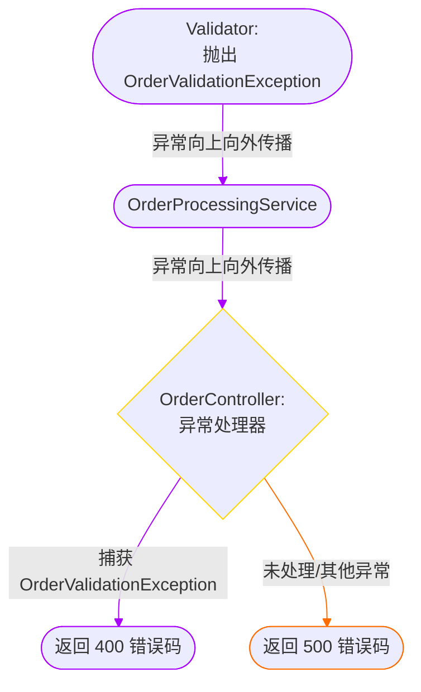
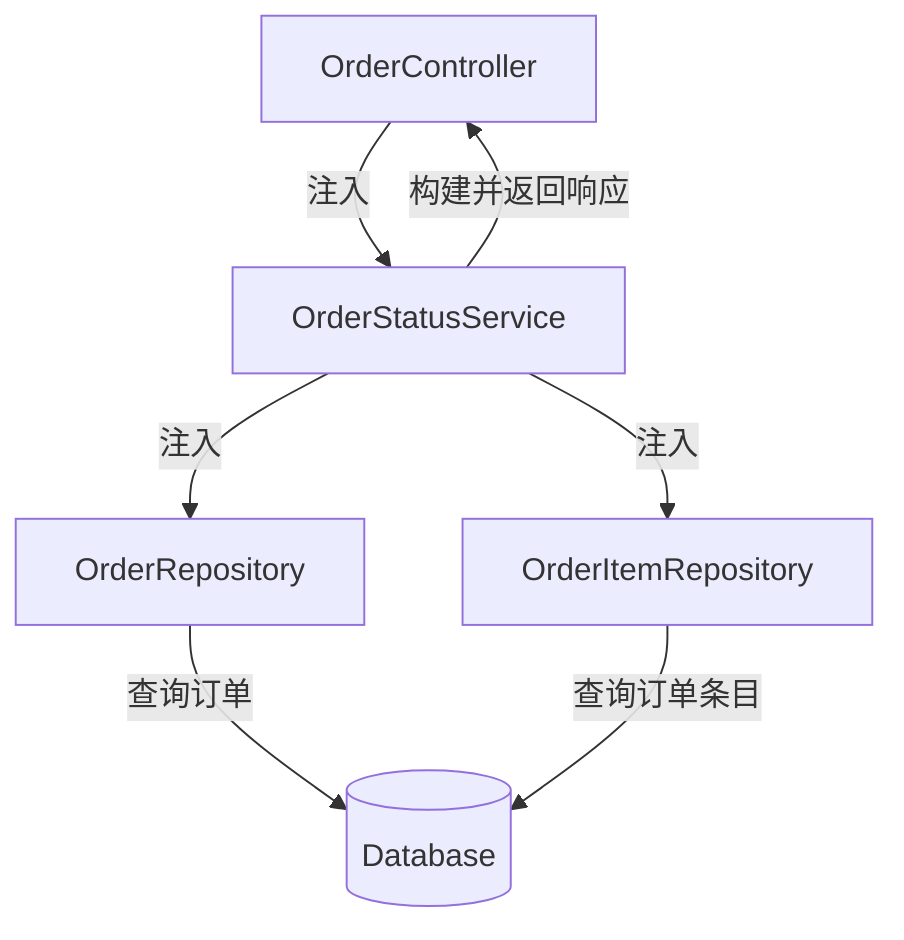

# 任务 2 ~ 开启开发之旅

在本任务中，我们将聚焦于下单（Order Placement）流程。我们将审查用于下单的现有 API，但它目前尚未达到生产就绪状态。在本次任务中，你将：

- 为 UUID 字段和客户信息（Customer Details）实现新的校验器。
- 更新 Controller，使无效请求体返回 400 状态码。
- 实现一个获取订单状态（Order Status）的新 API 并返回正确的响应。
- 理解生产环境中自定义异常（Custom Exceptions）的重要性。

---

### **在继续之前，请先阅读本节内容：**

**设计决策**

在该项目中，我采用了清晰且可扩展的设计，使用接口和抽象类来处理通用与可变的订单处理逻辑。`AbstractOrderProcessor` 类定义了共享的工作流（如保存订单），同时将 `processOrder()` 等方法留为抽象方法，由子类实现各自特定的业务逻辑。我们将针对不同的订单类型拥有多个处理器，它们都将继承 `AbstractOrderProcessor` 类并在共享逻辑的基础上构建。

这种方法符合 SOLID 原则和模板方法（Template Method）设计模式，使代码库更易维护、可测试且具备良好扩展性。通过对所有处理器强制执行一致的结构并集中共享行为，该设计确保了添加新类型的处理器变得简单直接，且不会破坏现有功能——这是企业级应用程序的重要特性。

**保持简单的数据库关联关系**

我刻意避免使用 `@OneToMany`、`@ManyToOne` 和 `级联（cascading）` 关联关系，以保持数据访问逻辑的显式性和对初学者友好。虽然 JPA 提供了强大的自动管理实体关系的工具，但它们通常会引入隐藏的行为，可能让刚接触 Spring Boot 和 JPA 的人感到困惑。通过手动处理关联（通过 ID 和独立的查询或服务层组合），我可以完全控制数据的加载、更新和删除。这种方法避免了诸如意外级联操作、懒加载问题或双向序列化问题等潜在陷阱，随着开发者理解底层概念，应用程序将更容易理解、调试和扩展。

_欢迎你根据自己的喜好更新/修改现有逻辑。_

**使用 Lombok**

对于不熟悉 Lombok 的人来说，它是一个帮助减少样板代码（boilerplate code）的 Java 库。它提供了一些极其有用的注解，例如 `@Data`、`@RequiredArgsConstructor`、`@Builder`、`@Slf4j` 等。你会看到我在整个项目中大量使用这些注解。我最喜欢的几个注解包括：

- `@Data`：此注解为类自动生成 getter、setter、equals、hashCode 和 toString 方法。
- `@Builder`：此注解允许你使用建造者模式创建对象，使代码更加整洁易读。
- `@RequiredArgsConstructor`：此注解在编译期生成包含必需参数（final 字段）的构造函数。
- `@Slf4j`：此注解为类生成日志记录器。你可以使用 `log.info()`、`log.error()` 等来输出日志。

---

## **下单流程（Order Placement Flow）**

**背景**

我们假设上游服务（可以是前端组件或另一个微服务）向我们发送新订单请求，我们的应用程序需要优雅地处理这些请求。在总体层面上，下单流程如下所示：


下单流程是任何企业运营的关键环节，因为它直接影响客户满意度、库存管理和收入确认。该流程通常从接收订单请求开始，请求可能来自各种渠道（如在线商城、移动 App 或内部销售系统）。一旦接收到订单，系统会执行一系列校验以确保数据的准确性和完整性——包括检查产品是否有货、校验价格以及确认客户信息。

---

## **进入编码环节**

### **OrderController**

导航至 [src/main/](../../src/main/java/com/springboot/learning/kit)，这是应用程序核心代码所在的位置。展开 [Controller](../../src/main/java/com/springboot/learning/kit/controller) 包并打开 `OrderController.java` 文件。

你会注意到该类中没有显式的构造函数，这是因为我们使用了 Lombok 的 `@RequiredArgsConstructor` 注解。该注解在编译期生成包含必需参数（final 字段）的构造函数。这是减少样板代码并使类更整洁的高效方式。


现在看一看带有 `@PostMapping` 注解的 `submitOrder` 方法。该方法通过 `@RequestBody` 接收订单请求体，并将其向下传递给 `OrderProcessingService`。

**注意：** _Controller 类不应包含任何业务逻辑，也不应直接调用数据库或外部服务。正如你所看到的，我们只是将 `OrderRequest` 传递给 `OrderProcessingService`。_

---

### **OrderProcessingService**

现在导航到 `OrderProcessingService`。你会注意到该类带有 `@Service` 注解，表示它是 Spring 上下文中的服务类。我们同样在这里使用 `@RequiredArgsConstructor` 来注入依赖项。

#### **订单校验（Order Validation）**

下单流程的第一步是校验订单，这由 `OrderValidationService` 完成。如果你导航到 `validateOrder` 方法，会发现当前仅对 OrderType 进行了校验。你可以查看 [OrderType.java](../../src/main/java/com/springboot/learning/kit/domain/OrderType.java)，其中包含我们的服务需要处理的不同订单类型的枚举。

**小技巧：** _点击下方所示的圆形小图标，即可快速在左侧目录树中定位到当前打开的类所在文件夹：_


我们来为 `uuid` 字段添加一个新的校验器类。该校验器将检查 `uuid` 是否有效：

- 在 `validator` 包下创建一个新类 `OrderUUIDValidator`。
- 为该类添加 `@Component` 注解，使其成为 Spring Bean 并允许被注入到其他类中。
- 实现 `Validator<Long>` 接口，因为 UUID 字段的类型是 `Long`。
- 此时 IDE 会提示你使用 `@Override` 注解实现 `validate()` 方法。

**需求：**
该校验器应进行以下检查：
- 检查 UUID 是否为 null。
- 检查 UUID 是否为负数。
- 如果满足上述任一条件，则抛出带有相应错误信息的自定义 `OrderValidationException`。

你的类应该如下所示：


现在你可以将此校验器注入到 `OrderValidationService` 类中，并在 `validateOrder` 方法中使用它，就像之前对 `OrderTypeValidator` 所做的那样。

太棒了，你已经实现了该校验器，但是我们的 `/submit` API 还有一个问题：回顾 controller，你会发现出现任何失败时它都会返回 INTERNAL_SERVER_ERROR (500) 状态码。让我们修复它，使客户端在发送错误请求体时返回 BAD_REQUEST (400) 状态码。

⚠️ **说明：** _在本练习中，我将使用 try-catch 块来处理自定义异常。但你也可以使用 `@ControllerAdvice` 进行全局异常处理。在 Spring Boot 应用程序中，这是更加优雅的处理方式。_

**实现步骤：**
- 在 `try{}` 后添加一个新的 `catch()` 块。
- 该 catch 块应捕获 `OrderValidationException`，因为校验器抛出的是此异常。
- 返回带有 `HttpStatus.BAD_REQUEST` 状态码的 `ResponseEntity`。
- 我们还需要返回异常中的错误信息，以便客户端了解具体出错原因。

**自定义异常的使用：**

自定义异常提供了一种以更有意义、更结构化的方式处理错误的强大机制。在企业级 Java 应用程序中创建自定义异常是非常普遍且符合行业标准的，尤其是在构建 REST API 时。在我们的例子中，[OrderValidationException](../../src/main/java/com/springboot/learning/kit/exception/OrderValidationException.java) 是一个继承自 `RuntimeException` 的自定义异常。所有自定义异常都应该存放在 `exception` 包中。

下图展示了自定义异常如何由校验器抛出并在 controller 中被捕获的流程：



完成之后，你的 `submitOrder` 方法应该如下所示：


**测试时间：**

启动应用程序，并使用负数 UUID 调用 `/submit` API：


可以看到我们获得了 400 响应状态码以及我们在异常中提供的错误信息。
**你现在应该通过不传 UUID 发起下单测试此 API，看看是否能够获得预期的错误响应。**

---

### **进一步完善校验机制**

仅校验 UUID 和 OrderType 是不够的。在实际的生产系统中，你需要校验请求体中的大部分字段，这可能包括：

- 客户地址（Customer Address）
  - 街道地址不能为空
  - 城市不能为空
  - 邮政编码不能为空且有效
  - 国家不能为空且有效
- 客户详情（Customer Details）
  - 姓名不能为空
  - 邮箱不能为空且不包含任何特殊字符
  - 电话号码不能为空且不包含任何特殊字符
- 订购商品及其数量
- 货币代码有效
- 配送方式与运费

这些组件目前尚未实现，但你可以开始思考如何实现它们。每个组件都应有自己独立的 Validator 类，并与其他代码隔离，以保持代码整洁、易于维护和测试。

---

### **对客户详情进行校验**

让我们实现另一个校验器，用于校验 `CustomerDetailsRequest` 对象中的 3 个字段。
像之前处理 UUID 一样，在 `validator` 包中创建一个新类 `CustomerDetailsValidator`。

**注意：** _新校验器需要实现 `Validator<CustomerDetailsRequest>` 接口。因为我们要校验的是 `CustomerDetailsRequest` 对象。_

**需求：**
- 姓名不能为空。
- 邮箱不能为空且不应包含任何特殊字符。
- 邮箱格式必须有效。
- 电话号码不能为空且不应包含任何特殊字符。

让我们为邮箱校验引入一个新依赖。打开 `build.gradle` 文件，在 `dependencies {}` 代码块中添加以下依赖：

`implementation "com.sun.mail:jakarta.mail:2.0.1"`

_你可以在 [Maven 仓库](https://mvnrepository.com/artifact/com.sun.mail/jakarta.mail/2.0.1) 找到该依赖的最新版本。_

添加依赖后，你可以点击编辑器中出现的小 Gradle 图标来刷新项目：


Gradle 会自动下载依赖并添加到你的项目中。

现在回到 `CustomerDetailsValidator` 类并实现 `validate()` 方法。你应该针对需要校验的每个字段创建 3 个私有方法。例如：


姓名校验部分很简单，因为只需确保姓名不为空即可。
但在处理电话和邮箱时，我们将使用 `jakarta.mail` 包中的 `EmailValidator` 类，并使用正则表达式来校验电话号码。

**姓名校验：**
如果姓名为空，抛出带有相应错误信息的 `OrderValidationException`：


**邮箱校验：**
你可以看到我们用 `try-catch` 块包裹了校验逻辑。如果校验失败，将抛出带有相应信息的自定义 `OrderValidationException`：


**电话号码校验：**
对于电话号码校验，我们使用正则表达式来检查电话号码是否包含非法字符。
正则表达式为：`^\+?(\d{1,3})?[-.\s]?(\(?\d{3}\)?[-.\s]?)?(\d[-.\s]?){6,9}\d$`


### **测试这些改动**
实现 `CustomerDetailsValidator` 后，将其注入到 `OrderValidationService` 类中。
完成后，启动应用程序。

以下是一些失败场景的截图，但你应该尝试测试所有你能想到的情况：


---

## **订单状态（Order Status）**

订单状态是任何订单处理系统的另一个关键组成部分。如果你查看 [OrderItemService](../../src/main/java/com/springboot/learning/kit/service/OrderItemService.java) 类，会看到它使用转换器将 `OrderItemRequest` (DTO) 转换为 `OrderItem` (Entity) 对象。在此过程中，我们将所有新创建订单的 `status` 字段默认设置为 `PROCESSING`。我们将使用此字段来跟踪订单状态，并在收到上游服务更新时更新状态。

现在，你将实现一个从数据库中检索订单状态的新 API。请将此任务当作真实的生产任务对待。

**需求：**
- 实现一个获取订单状态的新 API。
- 该 API 应使用 `@PathVariable` 注解接收 `UUID` 作为路径参数。
- 该 API 应从数据库中获取数据并返回 [OrderStatusResponse](../../src/main/java/com/springboot/learning/kit/dto/response/OrderStatusResponse.java) 对象。
- 如果数据库中未找到该订单，API 应返回 404 状态码。
- 如果发生任何其他错误，API 应返回 500 状态码。

#### **实现建议：**

- 查看 `order/submit` API，了解其实现方式。
- 遵循该模式在 `OrderController.java` 类中实现新 API。
- 在 service 包中创建一个名为 `OrderStatusService.java` 的新类。
- 将 `OrderStatusRepository` 注入到新服务类中。
- `OrderStatusRepository` 应使用 `@Query` 注解，提供自定义 SQL 查询来检索订单状态。
- 现在将新服务类注入到 `OrderController` 中，以从服务层拉取状态。



_*** 🚧 在查看以下解决方案之前，请先尝试自己动手实现 ***_

### **解决方案**

以下是我处理该任务的方式。首先，我在 service 包中创建了一个新类 `OrderStatusService`。
该类注入了 `OrderRepository` 和 `OrderItemRepository`，这样我就可以从 `Order` 表中提取 `OrderType` 字段，并从 `OrderItem` 表中提取 `OrderItem` 记录。

**OrderController**

我的 API 根据不同场景返回不同的响应码。你可以看到我使用自定义 ⚡️ 异常 `OrderNotFoundException` 来处理在数据库中找不到订单的情况。妥善处理此类情况并向客户端返回有意义的错误信息非常重要。

_此外，你可以看到我使用了 Lombok 的 `@Slf4j` 注解所提供的 `log.error()`，在 `catch{}` 块中将错误信息输出到控制台。在生产环境中排查故障时，这些日志极其有价值。_


这是我的新方法：


**OrderStatusService**

该类包含从数据库中获取必要数据并为 API 构建响应对象的业务逻辑。

_请注意，我在这里抛出了一个自定义异常，可以在上游优雅地捕获该异常以向客户端返回准确的响应：_


**OrderItemRepository**

你可以看到我必须在该 repository 中创建一个遵循 Spring Data JPA 命名约定的新方法，它将自动生成一个查询，查找所有 `orderId` 字段与给定参数匹配的 `OrderItem` 实体。这是 Spring Data JPA 的强大功能，允许你在不编写任何 SQL 代码的情况下创建查询。


在底层，Spring Data JPA 将生成类似于下面的 SQL 查询，并将结果收集到 `OrderItem` 对象列表中：

```sql
SELECT * FROM order_items WHERE order_id = :orderId;
```

---

### **测试新 API**

使用 `/submit` API 下一个测试订单，将新 API 添加到 Bruno collection 中，然后使用刚创建的订单 `UUID` 调用新 API。

成功场景下，你的应用程序应返回 `200` 响应码及以下响应体：

```json
{
  "orderId": 1234567,
  "orderType": "ONLINE",
  "items": [
    {
      "productId": 1,
      "quantity": 2,
      "status": "PROCESSING"
    },
    {
      "productId": 2,
      "quantity": 1,
      "status": "PROCESSING"
    }
  ]
}
```

如果数据库中不存在该订单，应返回 `404` 响应码及以下响应体：

```json
{
  "message": "Order not found with UUID: 123456788"
}
```

如果数据库中该订单没有任何商品明细，应返回 `404` 响应码及以下响应体：

```json
{
  "message": "No order items found for order with UUID: 123456788"
}
```

如果数据库或应用程序出现其他任何问题，应返回 `500` 响应码及以下响应体：
```json
{
  "message": "Unable to retrieve order status"
}
```

---

### **任务小结**

本任务深入介绍了应用程序中的下单流程。我们首先为传入的订单请求实现了新的校验器，随后实现了一个检索订单状态的新 API。

我们还探讨了使用自定义 ⚡️ 异常的重要性，以及它们在生产环境中对于更清晰的错误处理、更具体的调试以及一致的 API 响应所带来的巨大价值。

完成此任务后，你应该也认识到了我们是如何将 Controller、Service 和 Repository 逻辑清晰地分层隔离的。这种分层结构有助于确保随着项目的扩大，代码库仍然保持整洁、易读且可维护。
