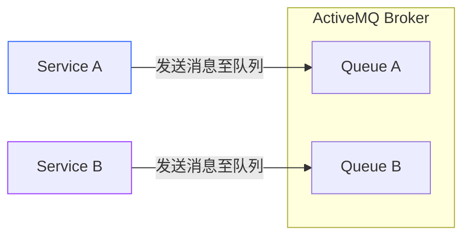
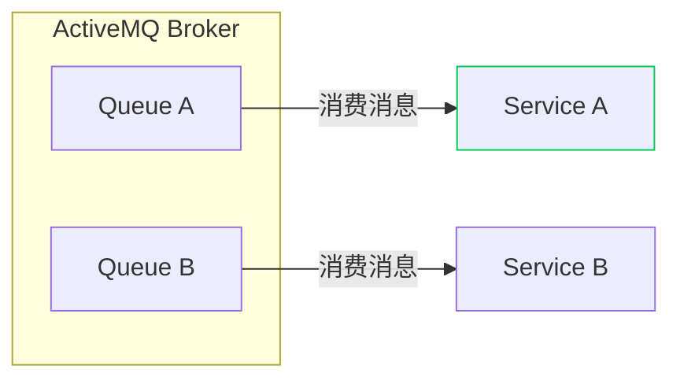
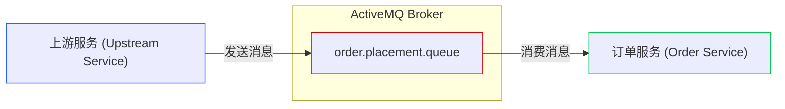
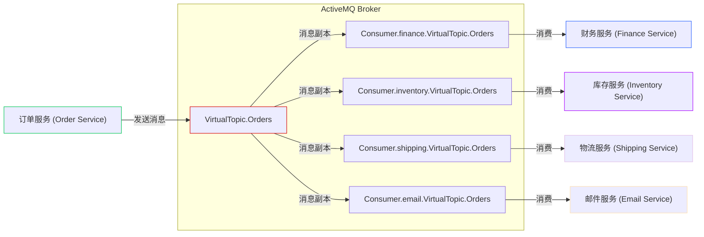
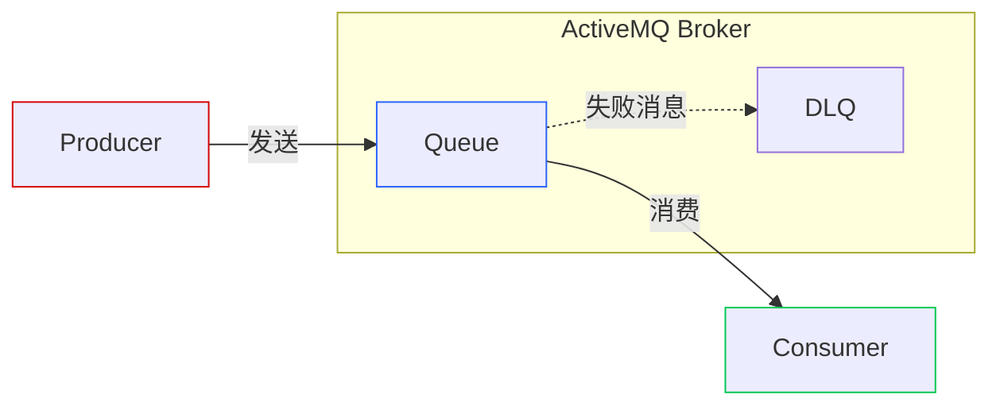

# 任务 4 - 使用 Apache ActiveMQ

本任务将引导你在生产级企业应用程序中配置 ActiveMQ。之后，我们将探讨如何为 ActiveMQ 队列配置新的消费者（Consumer）和生产者（Producer）。

---

## **为什么要使用 ActiveMQ？**
ActiveMQ 是一个用 Java 编写的开源消息代理（Message Broker）。它广泛应用于企业级应用中，用于解耦组件并实现**异步通信**。它是实现发布-订阅（Publish-Subscribe）模式和点对点（Point-to-Point）消息传递的流行选择。

### **异步通信（Asynchronous Communication）**
我将通过下面简单的 Mermaid 图示来说明异步通信机制。

**生产者（Producer）**

生产消息的应用程序只需将消息发送到 ActiveMQ 代理并指定目标队列。ActiveMQ 接收到消息后，当前交互即告完成，生产者无需等待消费者处理该消息。从此时起，消息将存储在队列中，直到有可用的消费者来处理它。



**消费者（Consumer）**

消费者应用程序监听队列并处理消息。请注意，一个应用程序可以拥有多个消费者，每个消费者从不同的队列中消费消息。



**队列（Queues）**

队列用于点对点通信。在此模型中，一条消息由一个生产者发送给一个消费者。在该项目中，监听前端事件的上游服务将通过队列向我们的应用程序发送消息。只有我们的应用程序应该监听该队列。这是一种一对一的通信模型。



**虚拟主题（Virtual Topics）**

主题用于发布-订阅通信。在此模型中，一条消息由一个生产者发送，可被多个下游消费者接收。在本项目中，我们的 `Order Service` 应用程序将向 Topic 发送事件，该 Topic 在下游拥有多个消费者。

_**注意：** ActiveMQ 中的虚拟主题需要特定前缀才能生效：`VirtualTopic.<TopicName>`_
_并且为了订阅该 VT，你需要按照此格式创建队列：`Consumer.<serviceName>.VirtualTopic.<TopicName>`。然后你的应用程序从该特定队列中消费消息。_



**死信队列（Dead Letter Queue - DLQ）**

死信队列（DLQ）是一种特殊类型的队列，用于存储消费者无法处理的消息。导致这种情况的原因有很多，比如消费者不可用或消息格式错误。通常情况下，没有任何应用主动从此队列消费。可以对该队列中的消息进行监控和分析，以查明问题的根本原因。



---

## **ActiveMQ 环境配置**

### **属性配置文件**
让我们看看 ActiveMQ 在本项目中是如何配置的。首先，查看 [application-local.properties](../../src/main/resources/application-local.properties) 文件。你会发现我们定义了 ActiveMQ broker 的 URL 以及凭据：


如果你查看同一目录下的其他属性文件，会发现每个环境的 URL 均不相同。这是因为我们使用 Spring Profiles 为不同环境定义了不同的属性。

### **Java 配置类**
定义属性后，我们需要创建一个配置类来设置 ActiveMQ 连接工厂（ConnectionFactory）。在 `config` 包下我们已经有一个名为 [ActiveMQConfig](../../src/main/java/com/springboot/learning/kit/config/ActiveMQConfig.java) 的类。该类带有 `@Configuration` 注解，告知 Spring 该类包含配置信息。该类还带有 `@EnableJms` 注解，用于在 Spring 中启用 JMS 支持。

Broker 配置通过 `@Value` 注解从属性文件中读取：


你还可以查看同一文件中的另外两个 Bean，它们定义了 `ConnectionFactory`。`ConnectionFactory` 用于创建与 ActiveMQ 代理的连接。

---

### **使用 Apache Camel 配置路由**

现在，让我们看一下 broker 与应用程序之间的路由是如何定义的。实现这一目的有多种方式。Spring Boot 提供了不同的注解（如 `@JmsListener`）用于将消费者绑定到队列。但本项目中我们使用了 **Apache Camel**。Apache Camel 是一个开源的集成框架，提供了丰富的组件用于集成不同系统。在 ActiveMQ 上下文中，它提供了一种在 broker 与应用程序之间定义路由的优雅方式。

**为什么企业偏好使用 Apache Camel？**

默认情况下，你可以通过 `@JmsListener` 注解来配置消费者。但在大型企业级应用中，这并不是最佳实践。这种配置往往分散在多个类中，难以集中管理。在生产就绪的系统中，可能有大量的消费者和生产者，分散的配置会让消息路由与管理变得非常混乱。

Apache Camel 允许你在 broker 和应用程序之间定义清晰、集中的路由。它使用 DSL（领域特定语言）来定义路由。所有路由都可以集中配置在一处，便于维护大规模应用。它还提供了重试、错误处理、过滤等开箱即用的特性。

**来看代码实现！**

ActiveMQ 的路由定义在 `routes` 包下的 [ActiveMQRoutes](../../src/main/java/com/springboot/learning/kit/routes/ActiveMQRoutes.java) 类中。你可以看到该类继承了 Apache Camel 提供的 `RouteBuilder` 类：


现在我们来看每个路由是如何定义的。通过重写 `configure()` 方法来定义路由：


 
- `from()` 方法用于定义消息源。在本例中，我们使用 `activemq:queue:amq.order.placement.queue`，意味着消息将从 `amq.order.placement.queue` 队列中消费。
- `routeId()` 方法用于定义路由的唯一标识符（ID）。必须保证唯一，用于日志记录和调试排查。
- `log()` 方法用于记录从队列中消费的消息，便于调试。
- `onException()` 方法用于定义路由的异常处理逻辑。在这里，我们定义了 `maximumRedeliveries(x)` 策略，意味着如果消费者在处理消息时遇到任何 Exception，在将其发送到死信队列（DLQ）之前会重试 'x' 次。
- `maximumRedeliveries(x)` 后面的 `to()` 方法用于指定失败消息的归宿 DLQ。在本例中，我们指示 Camel 将消息发送到 `amq.order.placement.queue.dlq` 队列。
- 随后带有 **ERROR** 级别的 `log()` 方法用于记录发送到 DLQ 的消息日志。
- `handled()` 方法用于将异常标记为已处理。默认情况下，Camel 会不断重试消息，直到成功或送入 DLQ。使用 `handled()` 表明我们已经妥善处理了该异常，不需要再向外传播重试。
- `end()` 方法表示 `onException()` 代码块的结束。
- `bean()` 方法用于指定负责处理消息的 Bean。在本例中，我们将此路由指向 [NewOrderConsumer](../../src/main/java/com/springboot/learning/kit/consumer/NewOrderConsumer.java) 类。第二个参数是用于处理消息的方法名。在这里，我们调用 `NewOrderConsumer` 类的 `processActiveMQOrder()` 方法。
- 最后的 `log()` 方法用于记录消费者处理完毕的消息日志，便于调试跟踪。

希望这能让你清楚理解本项目中 ActiveMQ 的 Camel Route 是如何配置的。

---

## **下单消费者（Order Placement Consumer）**

查看 [NewOrderConsumer](../../src/main/java/com/springboot/learning/kit/consumer/NewOrderConsumer.java) 类，你会发现它接收一个 String 类型的消息，然后使用 `ObjectMapper` 类将其转换为 `OrderRequest` 对象。我们接收 JSON 字符串并将其反序列化为 `OrderRequest` 对象。

_**注意：** `ObjectMapper` Bean 配置在 `config` 包下的 `JacksonConfig` 类中。没有它，Spring 将无法初始化 `ObjectMapper` Bean，你将遇到 `NullPointerException`。_

该消费者将 `OrderRequest` 对象传递给负责处理订单的 `OrderService` 类。下游其余流程与我们在 `OrderController` 类中实现的完全一致，因为 Controller 和 Consumer 共用同一个 `OrderService` 类。

## **通过 ActiveMQ Web 控制台向队列发送消息**

### **ActiveMQ Web 控制台**

访问 [http://localhost:8161/admin/queues.jsp](http://localhost:8161/admin/queues.jsp) 并使用用户名 `admin`、密码 `admin` 登录。
如果你的应用程序当前处于运行状态，你应该能在 `amq.order.placement.queue` 旁看到 `1` 个活跃消费者。这表明我们的 Camel Route 处于活跃状态，应用程序已准备好从此队列消费消息。


- `Number of Pending Messages`：表示队列中等待被消费的消息数。
- `Number of Consumers`：表示当前正在从此队列消费消息的消费者数量。
- `Messages Enqueued`：表示已发送到队列但尚未被消费的消息总数。
- `Messages Dequeued`：表示已从队列中成功消费的消息总数。

### **向队列发送消息**

在最右侧的 `Operations` 列下，你应该能看到一个名为 `Send To` 的按钮。点击它，你将看到一个可以输入消息的表单：


现在，复制 [NewOnlineOrder.json](../../src/main/resources/payloads/NewOnlineOrder.json) 文件中的订单请求 JSON 并粘贴到 `Message Body` 区域。然后点击 `Send` 按钮。这会将消息发送到队列，并由我们的应用程序消费。

你应该能看到 `Messages Enqueued` 和 `Messages Dequeued` 计数各增加了 `1`。这表明消息已被我们的应用程序成功消费。

### **在日志中验证消息处理**

在 IntelliJ 中打开应用程序日志，你应该会看到如下日志：

```text
2025-04-18T19:59:21.240+01:00 ERROR 34262 --- [SpringBootLearningKit] [lacement.queue]] c.s.l.kit.consumer.NewOrderConsumer      : Received new ActiveMQ order message
Validating UUID: 12345
2025-04-18T19:59:21.249+01:00  INFO 34262 --- [SpringBootLearningKit] [lacement.queue]] c.s.l.k.processor.OnlineOrderProcessor   : Processing online order: 12345
Hibernate: insert into public.customer_details (email,name,phone) values (?,?,?)
Hibernate: insert into public.customer_address (city,country,state,street,zip_code) values (?,?,?,?,?)
2025-04-18T19:59:21.263+01:00  INFO 34262 --- [SpringBootLearningKit] [lacement.queue]] c.s.learning.kit.service.OrderService    : Saving new order: OrderRequest(UUID=12345, orderType=ONLINE, customerDetails=CustomerDetailsRequest(name=John Doe, email=john.doe@email.com, phone=+1234567890), customerAddress=CustomerAddressRequest(street=123 Main St, city=New York, state=NY, zipCode=10001, country=USA), orderItems=[OrderItemRequest(productId=1, quantity=2, pricePerUnit=29.99), OrderItemRequest(productId=2, quantity=1, pricePerUnit=49.99)], orderAmount=109.97, currency=USD)
Hibernate: insert into public.order (currency,customer_address_id,customer_details_id,order_created,order_type,total_amount,uuid) values (?,?,?,?,?,?,?)
Hibernate: insert into public.order_items (order_id,price_per_unit,product_id,quantity,status) values (?,?,?,?,?)
Hibernate: insert into public.order_items (order_id,price_per_unit,product_id,quantity,status) values (?,?,?,?,?)
2025-04-18T19:59:21.277+01:00  INFO 34262 --- [SpringBootLearningKit] [lacement.queue]] orderPlacementRoute                      : Order processed successfully
```

你可以在最后看到 `Order processed successfully` 的日志。该日志正是由 Apache Camel 路由插入的。

### **验证订单状态**

此外，你可以通过调用 `order/status/{uuid}` 接口来验证订单状态。你应该会收到以下响应，表明订单已成功处理且处于 `PROCESSING` 状态：

```json
{
  "orderId": 12345,
  "orderType": "ONLINE",
  "items": [
    {
      "productId": 1,
      "quantity": 2,
      "status": "PROCESSING"
    },
    {
      "productId": 2,
      "quantity": 1,
      "status": "PROCESSING"
    }
  ]
}
```

---

## **测试死信队列（DLQ）功能**

### **模拟失败**

我们知道，如果尝试使用相同的 UUID 下单，应用程序现在会抛出重复订单异常（Duplicate Order Exception）。因此，我们可以利用这一点来测试 DLQ 路由是否配置正确并按预期工作。

我们应该在应用程序中观察到以下行为：
- 第一条消息处理失败，并将重试 `1` 次（根据 `ActiveMQRoute` 中的配置）。
- 重试 `1` 次后，消息将被发送到 DLQ。
- 该消息将在应用程序日志中以 `ERROR` 级别记录。
- 消息将从原队列中移除，不会再被重复处理。
- 消息将进入 `amq.order.placement.queue.dlq`，我们可以通过 ActiveMQ Web 控制台进行验证。

### **发送重复订单**

当你再次发布之前使用过的相同请求体时，应该会看到如下日志：

```text
2025-04-18T20:17:14.680+01:00 ERROR 34262 --- [SpringBootLearningKit] [lacement.queue]] c.s.l.kit.consumer.NewOrderConsumer      : Received new ActiveMQ order message
Validating UUID: 12345
2025-04-18T20:17:14.715+01:00  INFO 34262 --- [SpringBootLearningKit] [lacement.queue]] c.s.l.k.processor.OnlineOrderProcessor   : Processing online order: 12345
Hibernate: insert into public.customer_details (email,name,phone) values (?,?,?)
Hibernate: insert into public.customer_address (city,country,state,street,zip_code) values (?,?,?,?,?)
2025-04-18T20:17:14.751+01:00  INFO 34262 --- [SpringBootLearningKit] [lacement.queue]] c.s.learning.kit.service.OrderService    : Saving new order: OrderRequest(UUID=12345, orderType=ONLINE, customerDetails=CustomerDetailsRequest(name=John Doe, email=john.doe@email.com, phone=+1234567890), customerAddress=CustomerAddressRequest(street=123 Main St, city=New York, state=NY, zipCode=10001, country=USA), orderItems=[OrderItemRequest(productId=1, quantity=2, pricePerUnit=29.99), OrderItemRequest(productId=2, quantity=1, pricePerUnit=49.99)], orderAmount=109.97, currency=USD)
Hibernate: insert into public.order (currency,customer_address_id,customer_details_id,order_created,order_type,total_amount,uuid) values (?,?,?,?,?,?,?)
2025-04-18T20:17:14.784+01:00  WARN 34262 --- [SpringBootLearningKit] [lacement.queue]] o.h.engine.jdbc.spi.SqlExceptionHelper   : SQL Error: 0, SQLState: 23505
2025-04-18T20:17:14.785+01:00 ERROR 34262 --- [SpringBootLearningKit] [lacement.queue]] o.h.engine.jdbc.spi.SqlExceptionHelper   : ERROR: duplicate key value violates unique constraint "order_pkey"
  Detail: Key (uuid)=(12345) already exists.
2025-04-18T20:17:14.789+01:00 ERROR 34262 --- [SpringBootLearningKit] [lacement.queue]] c.s.learning.kit.service.OrderService    : Error saving order: 

org.hibernate.exception.ConstraintViolationException: could not execute statement [ERROR: duplicate key value violates unique constraint "order_pkey"
  Detail: Key (uuid)=(12345) already exists.] [insert into public.order (currency,customer_address_id,customer_details_id,order_created,order_type,total_amount,uuid) values (?,?,?,?,?,?,?)]
......
......
......
2025-04-18T20:17:14.828+01:00 ERROR 34262 --- [SpringBootLearningKit] [lacement.queue]] c.s.l.kit.consumer.NewOrderConsumer      : Failed to process ActiveMQ order message: {
......
......
......
}
```

在此之后，随着应用程序重试该消息，你会再次看到相同的日志：

```text
2025-04-18T20:17:15.844+01:00 ERROR 34262 --- [SpringBootLearningKit] [lacement.queue]] c.s.l.kit.consumer.NewOrderConsumer      : Received new ActiveMQ order message
Validating UUID: 12345
2025-04-18T20:17:15.848+01:00  INFO 34262 --- [SpringBootLearningKit] [lacement.queue]] c.s.l.k.processor.OnlineOrderProcessor   : Processing online order: 12345
Hibernate: insert into public.customer_details (email,name,phone) values (?,?,?)
Hibernate: insert into public.customer_address (city,country,state,street,zip_code) values (?,?,?,?,?)
2025-04-18T20:17:15.862+01:00  INFO 34262 --- [SpringBootLearningKit] [lacement.queue]] c.s.learning.kit.service.OrderService    : Saving new order: OrderRequest(UUID=12345, orderType=ONLINE, customerDetails=CustomerDetailsRequest(name=John Doe, email=john.doe@email.com, phone=+1234567890), customerAddress=CustomerAddressRequest(street=123 Main St, city=New York, state=NY, zipCode=10001, country=USA), orderItems=[OrderItemRequest(productId=1, quantity=2, pricePerUnit=29.99), OrderItemRequest(productId=2, quantity=1, pricePerUnit=49.99)], orderAmount=109.97, currency=USD)
Hibernate: insert into public.order (currency,customer_address_id,customer_details_id,order_created,order_type,total_amount,uuid) values (?,?,?,?,?,?,?)
2025-04-18T20:17:15.867+01:00  WARN 34262 --- [SpringBootLearningKit] [lacement.queue]] o.h.engine.jdbc.spi.SqlExceptionHelper   : SQL Error: 0, SQLState: 23505
2025-04-18T20:17:15.867+01:00 ERROR 34262 --- [SpringBootLearningKit] [lacement.queue]] o.h.engine.jdbc.spi.SqlExceptionHelper   : ERROR: duplicate key value violates unique constraint "order_pkey"
Detail: Key (uuid)=(12345) already exists.
2025-04-18T20:17:15.868+01:00 ERROR 34262 --- [SpringBootLearningKit] [lacement.queue]] c.s.learning.kit.service.OrderService    : Error saving order:

org.hibernate.exception.ConstraintViolationException: could not execute statement [ERROR: duplicate key value violates unique constraint "order_pkey"
.....
.....
.....
```

在这之后，你应该在 `amq.order.placement.queue.dlq` 队列中看到 `Number of Pending Messages` 变为 `1`：


---

## **创建新的生产者（Producer）**

现在让我们探讨如何为 ActiveMQ 创建一个新的生产者。对于生产者而言，我们不需要像消费者那样创建显式的路由。

### **需求说明**
让我们通过添加一个新的生产者来扩展下单流程，该生产者将向虚拟主题（Virtual Topic）发送一个事件，通知下游服务已创建了新订单：

- 当提交 `ONLINE` 订单时，发送一个新订单已创建（Order Placed）事件。
- 新生产者应将事件发送到名为 `VirtualTopic.amq.new.order.placed.event` 的虚拟主题。
- 使用 `org.apache.camel.ProducerTemplate` 发送消息到虚拟主题，而不是使用 `JmsTemplate`。
- 消息应在订单成功保存到数据库且被应用程序处理完成后发送。
- 事件结构应如下所示：
```json
{
  "orderId": 12345,
  "orderType": "ONLINE",
  "eventType": "ORDER_PLACED",
  "timestamp": "2025-04-18T20:17:15.868+01:00"
}
```

### **实现步骤**
 
_**🚧 建议先尝试自己独立实现上述所有需求**_

=======================================================================================

现在分享我的实现方案。首先，我在 `kit` 包下创建了一个名为 `event` 的新包，并在其中创建了名为 `OrderEventType` 的枚举类。该枚举用于定义发送到虚拟主题的事件类型。随后我在同一包下创建了名为 `OrderPlacedEvent.java` 的新类。

**OrderEventType**


**OrderPlacedEvent**


**属性文件（Property File）**

接着我在 `application.properties` 文件中添加了新属性，定义新生产者要使用的虚拟主题名称：


**OrderEventProducer**

_请注意，我在这里使用了 `ProducerTemplate`，并在 VirtualTopic 名称前拼接了 `activemq:topic`。这使我们能够使用 Apache Camel 将消息发送到虚拟主题。_

`ProducerTemplate` 对队列和主题的处理方式如下：
- 对于队列：`activemq:queue:<queueName>`
- 对于主题：`activemq:topic:<VirtualTopic.topicName>`


**OrderEventProducerException**

在上面的截图中，你可以看到我还为该生产者创建了一个新的自定义异常 `OrderEventProducerException`。目前虽然没有在任何地方捕获它，但拥有自定义异常可以使错误堆栈更清晰易懂。

**OrderEventTransformer**

接着我在 `transformer` 包下创建了一个名为 `OrderEventTransformer` 的新类，用于将 `OrderRequest` 对象转换为 `OrderPlacedEvent`。此类也可以用于为其他生产者转换各类事件。


**OrderService**

随后，我在现有的 `OrderService` 类中添加了一个新方法，用于调用新生产者将事件发送到虚拟主题。该方法使用新的转换器类生成 `OrderPlacedEvent` 对象并传递给新生产者：


---

## **测试验证**

现在让我们测试新生产者。你可以使用之前相同的请求体下单。

**创建新的虚拟主题**

我们需要通过 ActiveMQ Web 控制台手动创建虚拟主题。点击 `Topics` 标签页，然后使用 `Create` 选项创建新主题：


**创建新队列**

对于本次测试，我们在 ActiveMQ Web 控制台中手动创建一个名为 `Consumer.emailservice.VirtualTopic.amq.new.order.placed.event` 的队列。

你可以使用控制台界面中的 `Create` 选项来创建：


**向队列发送消息**

让我们下一个新订单以触发 OrderPlaced 事件。你可以通过 `order/submit` 接口发起，也可以通过 ActiveMQ Web 控制台向订单提交队列发送消息。

你应该能看到一条新消息已进入监听该虚拟主题的队列中：


点击该队列，你可以打开消息查看载荷内容，以确认消息已正确发送：


**🎉 恭喜！你已成功使用 Apache Camel 为 ActiveMQ 创建了新的生产者，它会在接收并处理新消息后发布更新。**

---

## **小结**

在本任务中，我们学习了如何在生产就绪的企业应用中配置 ActiveMQ。我们还学习了如何为 ActiveMQ 配置 Camel Route 以及如何从队列消费消息。此外，我们还掌握了如何向队列和主题发送消息，以及如何测试 DLQ 死信队列功能。

_**注意：** 在生产环境中，企业可能会对读写访问权限实施严格限制。因此你的应用程序只能对具有访问权限的队列进行读写。ActiveMQ broker 可以配置为多种不同模式，具体取决于企业的实际架构需求。_
