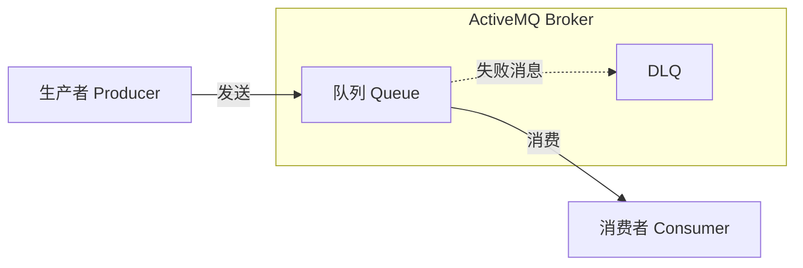
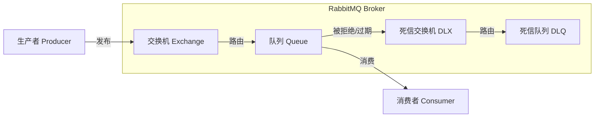
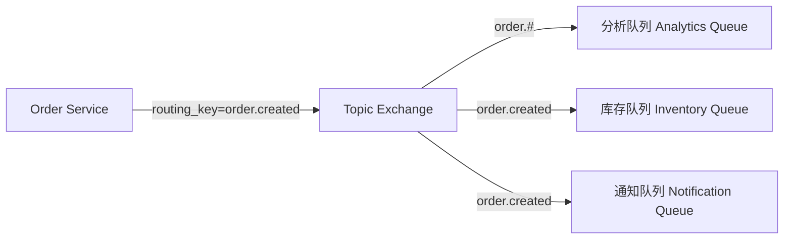
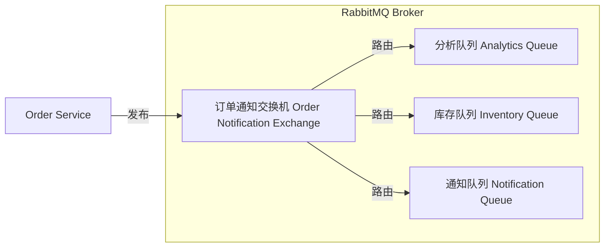

# 任务 5 ~ 使用 RabbitMQ

本任务将引导你为消费者和生产者配置 RabbitMQ。在此过程中，我们会发现现有配置中存在一些问题，需要我们逐一排查并修复。

---

## ActiveMQ 与 RabbitMQ 对比

**概念差异**
- **ActiveMQ** 遵循 JMS 风格的模型——队列（Queue）用于点对点通信，主题（Topic）用于发布-订阅通信。其路由方式更简单且高度抽象。
- **RabbitMQ** 使用交换机（Exchange），能够对消息如何路由到队列进行极其精准的控制。

以下是说明两者差异的简明示意图：

**ActiveMQ**


**RabbitMQ**



### **为什么 RabbitMQ 要使用交换机（Exchange）？**

如果你还没有深入了解过 RabbitMQ 的 Exchange，这里做个简明解释：RabbitMQ 中的交换机是一个路由组件，它接收生产者发送的消息，并决定如何将它们路由到一个或多个队列。它利用路由规则（Routing Rules）和绑定（Bindings）来决定每条消息的去向。

- **灵活性**：交换机允许你定义复杂的路由规则。你可以使用不同的 routing key 将多个队列绑定到同一个交换机。
- **解耦**：生产者与消费者完全解耦。生产者只需将消息发送到交换机，完全无需关心有哪些队列存在。
- **多种路由模式**：RabbitMQ 支持不同类型的交换机（Direct、Topic、Fanout、Headers）以满足各种路由场景。
- **负载均衡**：多个消费者可以共同监听同一个队列，从而实现负载均衡。

---



## **RabbitMQ 配置**

在上一任务中，我们通过 Apache Camel 配置了 ActiveMQ。RabbitMQ 同样可以使用 Apache Camel 配置。但对于 RabbitMQ，本项目直接通过 Spring Boot 原生方式进行配置。[RabbitMQConfig](../../src/main/java/com/springboot/learning/kit/config/RabbitMQConfig.java) 类负责配置 RabbitMQ 的连接。

现在你可以查看 [RabbitMQRoutes](../../src/main/java/com/springboot/learning/kit/routes/RabbitMQRoutes.java) 类，了解 RabbitMQ 队列与绑定的配置。当前我们配置了一个用于健康检查的队列，以及另一个用于接收新订单的队列。查看 [NewOrderConsumer](../../src/main/java/com/springboot/learning/kit/consumer/NewOrderConsumer.java) 类中的 `processRabbitMQOrder()` 方法，了解该方法是如何监听并处理队列消息的。

## **从 RabbitMQ 消费订单**

启动应用程序，打开 [RabbitMQ 管理控制台](http://localhost:15672/)。你应该可以在 `rmq.order.placement.queue` 队列旁边看到 1 个活跃消费者。


点击该订单提交队列进入详情页面。你应该能看到 `Publish Message` 区域。
在 `Payload` 中粘贴订单 JSON 内容，然后点击 `Publish Message` 按钮。这会将消息发布到该队列。


你应该会在控制台看到如下日志。应用程序从队列中消费了该消息并将其保存到数据库中。该消费者将消息传递给了与 ActiveMQ 消费者相同的 Order Processor：

```text
2025-05-23T19:34:27.616+01:00 ERROR 66821 --- [SpringBootLearningKit] [ntContainer#0-1] c.s.l.kit.consumer.NewOrderConsumer      : Received new RabbitMQ order message
Validating UUID: 1234569999
2025-05-23T19:34:27.647+01:00  INFO 66821 --- [SpringBootLearningKit] [ntContainer#0-1] c.s.l.k.processor.OnlineOrderProcessor   : Processing online order: 1234569999
```

## **修复当前 RabbitMQ 配置中的 Bug**

进入 RabbitMQ 管理控制台，使用相同的 UUID 发送重复订单。你会看到应用程序抛出了异常，并且陷入了无限循环重试该重复订单的状态。

🔧 **鼓励你先尝试自行排查 RabbitMQ 配置中的 Bug 并尝试修复。以下是详细排查过程。**

让我们检查 `RabbitMQRoutes` 类，因为队列和死信队列（DLQ）的绑定正是在这里定义的。仔细观察绑定订单提交队列的方法，你会发现我们在设置死信交换机（dead letter exchange）时错误地使用了 `EXCHANGE` 变量。
这意味着当消费者抛出异常时，消息会被发送到绑定在同一个业务交换机上的队列中！


我可以用一张简明图示来说明这个问题。你可以看到失败的消息在应用程序和业务交换机之间无限循环：

```mermaid
    flowchart LR
        A[上游生产者] -->|创建订单| B[订单业务交换机]
        B --> C[订单提交队列] --> |消费| D["订单服务"]
        D -.-> |将失败消息发回死信交换机 (误配成了业务交换机)| B
        
        subgraph "RabbitMQ Broker"
            B
            C
        end
```

### **解决方案**

我们需要将消息指向正确的死信交换机来打破这个无限循环。在 `RabbitMQRoutes` 类中创建一个新变量：


现在修复该方法中不正确的死信交换机绑定：


现在如果你查看 `dlqBinding` 方法，会发现我们把 DLQ 绑定到了业务 `exchange` 上。这也是不对的，它应该绑定到上面由 `@Bean` 定义的 `dlqExchange` 上：


让我们将其同样更改为 `dlqExchange`。此时你的配置应该如下所示：


### **测试改动**

1. 在 RabbitMQ 管理控制台中删除现有的 `rmq.order.placement.queue` 和 `rmq.order.placement.queue.dlq`。
   - 这也会一并清理为这些队列定义的旧绑定关系。
2. 重启应用程序。
3. 在 RabbitMQ 管理控制台查看你的订单提交队列和 DLQ。你应该能看到带有正确绑定关系的新建队列：
   -  
   - 
4. 再次发布一条带有相同 UUID 的订单消息。
5. 查看日志。

很遗憾，问题依然没有完全解决！消息依然没有正常进入 DLQ 稳定停驻。让我解释为什么即使修复了交换机映射，依然会发生这种情况。

### **RabbitMQ 中的自动重新入队机制（Automatic Re-queueing）**
RabbitMQ 具有自动重新入队（Automatic Re-queueing）的特性。这意味着当一条消息被消费者拒绝（rejected）或未被确认（not acknowledged / nack）时，RabbitMQ 默认会自动将该消息重新放回原队列并重新投递。
如果消费者持续拒绝同一条消息，或者从不向 RabbitMQ 发送 ACK，这就会导致**死循环**。

**那么，我们该如何解决？**

在 Spring Boot RabbitMQ 消费者中，有两种主要方式来阻止失败消息无限重试重新投递：

1. **在处理失败时抛出 `AmqpRejectAndDontRequeueException`**：
   在 `@RabbitListener` 标注的方法中抛出该异常。这会明确告知 Spring 和 RabbitMQ 该消息应被拒绝且**不得重新入队（requeue = false）**。
   如果队列配置了死信交换机（DLX），该消息将被正确路由到死信队列中。

2. **在底层消费者中使用手动确认模式（`autoAck = false`）**：
   这允许你在代码中显式调用 `ack()`、`nack()` 或 `reject()`。要将失败消息发送到 DLX，你必须调用 `nack()` 或 `reject()` 并传入 `requeue = false`。

对于本任务，我们将采用第一种方式，因为它更加简单直接。让我们用 try-catch 块包裹方法体，并在 catch 块中抛出 `AmqpRejectAndDontRequeueException`：


你可以阅读 RabbitMQ 官方文档了解更多细节：[Automatic Re-queueing](https://www.rabbitmq.com/docs/confirms#automatic-requeueing)。

### **再次测试**

1. 重启应用程序。
2. 再次发布带有相同 UUID 的重复订单消息。
3. 查看日志。你应该看到表明消息被拒绝的错误日志。
4. 此时，你应该能在 DLQ 中看到该消息已成功路由进去：
   - 

**现在我们拥有了一个带有正确死信交换机配置的正常工作的 RabbitMQ 架构 🎉**

---

## **向 RabbitMQ 发布消息**

现在我们来看看如何向 RabbitMQ 发布消息。在 ActiveMQ 中，我们向虚拟主题发送消息以让多个消费者都能消费该消息。而在 RabbitMQ 中，我们可以通过将消息发送给绑定了多个队列的交换机来实现这一点。结构大致如下：



**操作步骤：**
1. 通过 RabbitMQ 管理控制台创建一个名为 `rmq.new.order.notification.queue` 的新 `classic` 队列：
   - 
2. 打开该队列，向下滚动到 `Bindings` 区域：
   - 填写交换机 `amq.topic` 和 routing key `order.notification`，点击 `Bind` 按钮。
   - 
3. 在 `OrderEventProducer` 类中创建并从 `application.properties` 注入配置项：
   - 
4. 在 `OrderEventProducer` 类中创建一个将消息发布到 RabbitMQ 的新方法：
   - 
5. 像之前在 ActiveMQ 中所做的那样，在 `OrderService::PublishOrderPlacedEvent` 中调用该生产者方法。
6. 提交一个新订单。
7. 验证事件已发布到 RabbitMQ，并且消息成功进入了新建的队列：
   - 
   - 这是发布到队列中的具体消息内容：
   - 

### **生产者与消费者的解耦**
我们刚刚完成的工作体现了 RabbitMQ 中一个非常重要的核心概念：**生产者无需知道任何队列或消费者的存在**。
我们的应用程序仅仅是将带有 routing key 的消息发布到交换机上。交换机负责根据 routing key 将消息路由到匹配绑定的各个队列中。

你可以随意创建任意数量的队列，并将它们以 `order.notification` 为 routing key 绑定到同一个 `amq.topic` 交换机。应用程序发布的单条消息将被自动分发到你配置的所有队列中。

## **附加挑战（Bonus Task）**
当前 RabbitMQ 路由的配置方式还不够精简。想象一下如果我们需要添加更多队列，代码将变得冗长。你可以重构这些路由配置，使用统一的辅助方法来消除冗余，从而更容易添加新队列。如果你感兴趣，可以尝试动手优化。

## **结论**
在本任务中，我们完整体验了为消费者和生产者配置 RabbitMQ 的过程。我们还排查并修复了导致失败消息无限重试的配置 Bug。此外，我们创建了新队列并成功发布和路由了消息。希望本任务能帮助你更深入地理解 RabbitMQ 及其与 Spring Boot 的协作机制。
