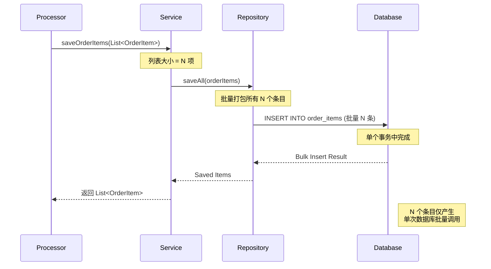

# 任务 6 ~ 数据库模式迁移与性能优化

Flyway 和 Liquibase 是数据库模式（Schema）迁移的两个行业标准工具。在本任务中，我们将使用 Liquibase 来管理数据库模式变更。

本任务将引导你在生产数据库中新增数据表或修改现有数据表。你还将学习如何使用 Liquibase 回滚变更。最后，我们还将探讨如何优化现有代码，确保将对数据库的调用次数降至最低。

---

## **任务 1：新增数据表**

让我们从在数据库中创建一张新表开始。此表将用于存储物流发货信息（Shipments）。前往 [changelog](../../src/main/resources/db/changelog) 目录并创建一个名为 `shipment_table.xml` 的新文件。该文件将包含用于创建发货表的变更集（changeset），Liquibase 会将其应用到数据库中。

```xml
<?xml version="1.0" encoding="UTF-8"?>
<databaseChangeLog
        xmlns="http://www.liquibase.org/xml/ns/dbchangelog"
        xmlns:xsi="http://www.w3.org/2001/XMLSchema-instance"
        xsi:schemaLocation="http://www.liquibase.org/xml/ns/dbchangelog
        http://www.liquibase.org/xml/ns/dbchangelog/dbchangelog-4.17.xsd">

    <changeSet id="shipment_1" author="waleed">
        <createTable tableName="shipments">
            <column name="shipment_number" type="BIGINT">
                <constraints primaryKey="true" nullable="false"/>
            </column>
            <column name="order_uuid" type="BIGINT">
                <constraints nullable="false"/>
            </column>
            <column name="warehouse_id" type="INT">
                <constraints nullable="false"/>
            </column>
            <column name="shipping_address_id" type="BIGINT">
                <constraints nullable="false"/>
            </column>
            <column name="total_amount" type="DECIMAL(19,4)">
                <constraints nullable="false"/>
            </column>
            <column name="shipping_cost" type="DECIMAL(19,4)">
                <constraints nullable="false"/>
            </column>
            <column name="currency" type="VARCHAR(3)">
                <constraints nullable="false"/>
            </column>
            <column name="shipment_created" type="TIMESTAMP">
                <constraints nullable="false"/>
            </column>
        </createTable>

        <addForeignKeyConstraint
                baseTableName="shipments"
                baseColumnNames="order_uuid"
                referencedTableName="orders"
                referencedColumnNames="uuid"
                constraintName="fk_shipment_order_uuid"/>

        <addForeignKeyConstraint
                baseTableName="shipments"
                baseColumnNames="shipping_address_id"
                referencedTableName="customer_address"
                referencedColumnNames="id"
                constraintName="fk_shipment_customer_address"/>

        <!-- 此部分帮助 Liquibase 生成回滚 SQL -->
        <rollback>
            <dropTable tableName="shipments"/>
        </rollback>
        
    </changeSet>

</databaseChangeLog>
```

该 changeset 将对数据库进行以下更改：
- 创建名为 `shipments` 的表。
- shipment 表包含以下列：
  - `shipment_number` (BIGINT，主键，非空)
  - `order_uuid` (BIGINT，非空，外键关联 order.uuid)
  - `warehouse_id` (INT，非空)
  - `shipping_address_id` (BIGINT，非空，外键关联 customer_address.id)
  - `total_amount` (DECIMAL(19,4)，非空)
  - `shipping_cost` (DECIMAL(19,4)，非空)
  - `currency` (VARCHAR(3)，非空)
  - `shipment_created` (TIMESTAMP，非空)
- 添加外键约束：
  - `order_uuid` 关联 `orders(uuid)`
  - `shipping_address_id` 关联 `customer_address(id)`

### 将新 changeset 引入 Master Changelog

要使该 changeset 生效，需要将其导入 [db.changelog-master.xml](../../src/main/resources/db/changelog/db.changelog-master.xml) 文件中。打开该文件并添加以下行：


---

### 使用 Liquibase 生成 SQL

首先，我们将使用 Liquibase 生成用于创建新表的 SQL 语句。

1. 确保本地数据库实例正在运行。
2. 打开终端并导航至项目根目录。
3. 运行以下命令生成 SQL：
   - `./gradlew updateSQL`
   - 查看终端，观察是否能看到以下日志：
   - `[2025-05-24 12:51:50] INFO [liquibase.ui] Output saved to src/main/resources/db/Migrate.sql`
   - 你很可能在终端中找不到该日志，这是因为我们的 `build.gradle` 文件中缺少了一项配置。
4. 向下滚动到 `build.gradle` 中的 `liquibase` 部分，插入如下所示的 `outputFile` 属性：
```groovy
// 为项目配置 Liquibase。没有此配置，./gradlew update 命令将无法正常输出
liquibase {
	activities {
		main {
			changeLogFile 'src/main/resources/db/changelog/db.changelog-master.xml'
			url 'jdbc:postgresql://localhost:5432/Order_Service'
			username 'user'
			password 'password'
			driver 'org.postgresql.Driver'
			outputFile 'src/main/resources/db/Migrate.sql'
		}
	}
	runList = 'main'
}
```
5. 现在再次运行该命令：
   - `./gradlew updateSQL`
   - 你应该能在终端中看到以下日志：
   - `[2025-05-24 12:51:50] INFO [liquibase.ui] Output saved to src/main/resources/db/Migrate.sql`

**验证生成的 SQL 文件**

你的 [Migrate.sql](../../src/main/resources/db/Migrate.sql) 文件现在应该包含了创建 shipment 表的 SQL 语句 🎉。打开该文件，验证它是否包含如下 SQL：

```sql
-- 锁定数据库
UPDATE public.databasechangeloglock SET LOCKED = TRUE, LOCKEDBY = 'localhost (192.168.0.165)', LOCKGRANTED = NOW() WHERE ID = 1 AND LOCKED = FALSE;

-- *********************************************************************
-- Update Database Script
-- *********************************************************************
-- Change Log: src/main/resources/db/changelog/db.changelog-master.xml
-- Ran at: 5/25/25, 8:06 PM
-- Against: user@jdbc:postgresql://localhost:5432/Order_Service
-- Liquibase version: 4.29.2
-- *********************************************************************

-- Changeset src/main/resources/db/changelog/shipment_table.xml::shipment_1::waleed
CREATE TABLE public.shipments (shipment_number BIGINT NOT NULL, order_uuid BIGINT NOT NULL, warehouse_id INTEGER NOT NULL, shipping_address_id BIGINT NOT NULL, total_amount DECIMAL(19, 4) NOT NULL, shipping_cost DECIMAL(19, 4) NOT NULL, currency VARCHAR(3) NOT NULL, shipment_created TIMESTAMP WITHOUT TIME ZONE NOT NULL, CONSTRAINT shipment_pkey PRIMARY KEY (shipment_number));

ALTER TABLE public.shipments ADD CONSTRAINT fk_shipment_order_uuid FOREIGN KEY (order_uuid) REFERENCES public."order" (uuid);

ALTER TABLE public.shipments ADD CONSTRAINT fk_shipment_customer_address FOREIGN KEY (shipping_address_id) REFERENCES public.customer_address (id);

INSERT INTO public.databasechangelog (ID, AUTHOR, FILENAME, DATEEXECUTED, ORDEREXECUTED, MD5SUM, DESCRIPTION, COMMENTS, EXECTYPE, CONTEXTS, LABELS, LIQUIBASE, DEPLOYMENT_ID) VALUES ('shipment_1', 'waleed', 'src/main/resources/db/changelog/shipment_table.xml', NOW(), 7, '9:7b5f7fff1bc2f802a6e595d21a59f534', 'createTable tableName=shipment; addForeignKeyConstraint baseTableName=shipment, constraintName=fk_shipment_order_uuid, referencedTableName=order; addForeignKeyConstraint baseTableName=shipment, constraintName=fk_shipment_customer_address, referenc...', '', 'EXECUTED', NULL, NULL, '4.29.2', '8199962613');

-- 释放数据库锁
UPDATE public.databasechangeloglock SET LOCKED = FALSE, LOCKEDBY = NULL, LOCKGRANTED = NULL WHERE ID = 1;
```

### 执行 Changeset

你可以通过以下两种方式执行该变更集：
1. **使用 Gradle 命令**：运行以下命令应用变更集：
   - `./gradlew update`
   - 这会将变更集应用到数据库并创建 shipment 表。
2. **使用 SQL 文件**：你也可以在 DBeaver 中直接在数据库上执行该 SQL 文件。打开 [Migrate.sql](../../src/main/resources/db/Migrate.sql) 文件并在数据库客户端中运行这些 SQL 语句。

---

### 🔄 生成回滚 SQL（Rollback SQL）

_⚠️ 注意：确保新的 ChangeSet 已经执行，并且数据库中确实包含了你想要回滚的新表/新列。_

我们还需要生成回滚 SQL，以便在部署出错时能够安全回滚数据库中的模式变更：

1. 运行以下命令，为指定数量的最近变更集生成回滚 SQL（此处回滚最近 1 个）：
   - `./gradlew rollbackCountSQL -PliquibaseCommandValue=1`
2. 此时你的 `Migrate.sql` 文件应该包含回滚 SQL，你可以在测试和生产数据库上运行它，以安全撤销最近一次变更集所做的修改：
```sql
-- 锁定数据库
UPDATE public.databasechangeloglock SET LOCKED = TRUE, LOCKEDBY = 'localhost (192.168.0.165)', LOCKGRANTED = NOW() WHERE ID = 1 AND LOCKED = FALSE;

-- *********************************************************************
-- Rollback 1 Change(s) Script
-- *********************************************************************
-- Change Log: src/main/resources/db/changelog/db.changelog-master.xml
-- Ran at: 5/25/25, 7:58 PM
-- Against: user@jdbc:postgresql://localhost:5432/Order_Service
-- Liquibase version: 4.29.2
-- *********************************************************************

-- Rolling Back ChangeSet: src/main/resources/db/changelog/shipment_table.xml::shipment_1::waleed
DROP TABLE public.shipments;

DELETE FROM public.databasechangelog WHERE ID = 'shipment_1' AND AUTHOR = 'waleed' AND FILENAME = 'src/main/resources/db/changelog/shipment_table.xml';

-- 释放数据库锁
UPDATE public.databasechangeloglock SET LOCKED = FALSE, LOCKEDBY = NULL, LOCKGRANTED = NULL WHERE ID = 1;
```

---

## **任务 2：改进 Liquibase 配置**

目前，Liquibase 配置直接写在 `build.gradle` 文件中。对于生产环境而言这并不理想，可能会导致版本控制与部署配置混乱。我们可以将此配置移至其专属文件，即 `liquibase.properties`。该文件将包含 Liquibase 的所有配置，包括数据库连接信息。

1. 在 `src/main/resources/liquibase` 目录下创建一个名为 `liquibase.properties` 的新文件。
2. 在 `liquibase.properties` 文件中添加以下配置：

```properties
# 数据库连接设置
changelog-file=src/main/resources/db/changelog/db.changelog-master.xml
url=jdbc:postgresql://localhost:5432/Order_Service
username=user
password=password
driver=org.postgresql.Driver

# 输出文件路径
outputFile=src/main/resources/db/Migrate.sql
```
3. 现在我们需要更新 `build.gradle` 文件以使用此新配置文件。
   将 `liquibase` 代码块中的属性替换为以下单行配置：

```groovy
liquibase {
    activities {
        main {
            defaultsFile 'src/main/resources/liquibase/liquibase.properties'
        }
    }
    runList = 'main'
}
```

4. 现在再次运行 `./gradlew updateSQL` 命令，验证 SQL 文件是否能成功生成。

**_你也可以为每个环境创建独立的 liquibase.properties 文件，但务必确保不要在测试和生产环境的配置文件中硬编码敏感凭据。_**

---

## **任务 3：优化现有代码**

新表和配置已经搞定，现在让我们看看如何优化现有的业务代码，以确保不产生不必要的数据库调用。在高流量的生产环境中，我们需要确保快速高效地处理请求。有时无意中产生的多余数据库调用可能会成为严重的性能瓶颈。

### **修复现有代码**

导航至 [AbstractOrderProcessor](../../src/main/java/com/springboot/learning/kit/processor/AbstractOrderProcessor.java) 类。
`saveOrder()` 方法负责将订单详细信息保存到数据库中。如果你查看保存订单条目（order items）的代码，会发现我们正在循环中针对每个订单条目单独调用一次数据库（IntelliJ 可能也对此弹出了警告 ⚠️）：

如果客户提交的订单包含数十个甚至上百个商品条目，这段代码将对数据库发起相应次数的独立写入调用。这是非常低效的，容易导致严重的性能问题。

```java
public void saveOrderItems(List<OrderItemRequest> orderItem, long orderUUID) {
        List<OrderItem> orderItemEntities = orderTransformer.transformOrderItemRequestToDomain(orderItem, orderUUID);
        for (OrderItem orderItemEntity : orderItemEntities) {
            orderItemRepository.save(orderItemEntity);
        }
    }
```

该问题可以通过以下时序图清晰展现：

```mermaid
sequenceDiagram
    participant C as Processor
    participant S as Service
    participant R as Repository
    participant DB as Database

    C->>S: saveOrderItems(List<OrderItem>)
    Note over S: 列表大小 = N 项

    rect rgb(40, 40, 40)
        Note right of S: 循环执行 N 次
        S->>R: save(orderItem1)
        R->>DB: INSERT INTO order_items
        DB-->>R: Result
        R-->>S: Saved Item
        
        S->>R: save(orderItem2)
        R->>DB: INSERT INTO order_items
        DB-->>R: Result
        R-->>S: Saved Item

        Note over S,DB: ... 还有 N-2 次调用 ...

        S->>R: save(orderItemN)
        R->>DB: INSERT INTO order_items
        DB-->>R: Result
        R-->>S: Saved Item
    end

    S-->>C: 返回保存的条目列表
```



**🔨 解决方案**

由于我们使用的是 Spring Data JPA，我们可以直接使用 `saveAll()` 方法，在一次数据库交互中批量保存所有的订单条目。这将形成批量的批量插入（batch insert），效率远远高于单个条目逐一写入。虽然这在一开始看起来似乎不是什么大事，但在真实生产环境中，如果高并发下应用因这种循环写入疯狂压榨数据库，极易导致数据库连接耗尽甚至客户端超时。

```java
    public void saveOrderItems(List<OrderItemRequest> orderItem, long orderUUID) {
        List<OrderItem> orderItemEntities = orderTransformer.transformOrderItemRequestToDomain(orderItem, orderUUID);
        orderItemRepository.saveAll(orderItemEntities);
    }
```

以下是更新后的时序图，展示了我们如何通过单次数据库调用完成所有订单条目的保存：



---

## **附加挑战（Bonus Task）**

- 在 Shipment 表对应的 ChangeSet 中新增一个变更，为 shipment 表添加一个类型为 `VARCHAR(50)` 的新列 `tracking_number`（物流追踪号）。

---

## **结论**

在本任务中，我们学习了如何在基于 Gradle 的 Spring Boot 应用中配置 Liquibase，以及开发者如何使用 Liquibase 管理数据库模式变更并在生产环境中安全地上线与回滚变更。我们创建了新表、生成了迁移 SQL 和回滚 SQL。
我们还通过将 Liquibase 配置迁移到独立的属性文件中优化了配置结构。
最后，我们重构了现有代码中的批量保存逻辑，消除了低效的多余数据库调用。

---
