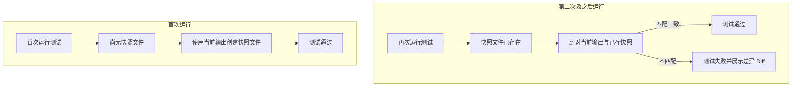
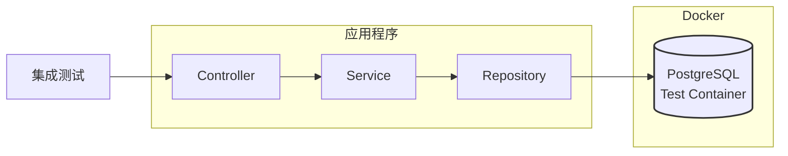

# 任务 7 ~ 单元测试与集成测试

单元测试和集成测试是构建生产就绪型应用程序的基石。
单元测试对各个独立组件进行隔离验证，确保每个 service、controller 或 utility 类在最细粒度级别上功能正确。而集成测试则验证不同组件在 Spring 上下文中的相互协作，包括数据库操作、REST 端点和消息队列。在生产环境中，停机可能会导致重大的业务损失。

在本任务中，我们将使用以下工具与技术：

- **JUnit**：Java 应用程序中广泛使用的测试框架。
- **Mockito**：一个允许你为测试创建 Mock 对象的测试替身框架。
- **Spring Test**：提供对 Spring 组件测试的支持，包括加载应用程序上下文和依赖注入。
- **Testcontainers**：一个允许你为集成测试运行 Docker 容器的库，确保测试环境的一致性。
- **快照测试（Snapshot Testing）**：一种捕获组件输出并将其与已保存的快照进行比对以确保一致性的技术。
- **AssertJ**：一个提供丰富断言集、支持链式调用的流式断言库。

---

## ⚠️ ⚠️ ⚠️ 关于 Docker Engine v29 与 Testcontainers 兼容性的重要更新
从 Docker Engine v29 开始，发生了一些重大变更，影响了 Testcontainers 与 Docker 的交互方式。
主要问题在于 Testcontainers 依赖的某些 Docker API 在 Docker Engine v29 中已被弃用。这导致了兼容性问题，致使 Testcontainers 在尝试启动容器或与 Docker 通信时发生故障。

在终端中运行以下命令，将 Docker API 版本设置为 1.44，该版本与我们项目中使用的 Testcontainers 版本兼容：
```bash
  echo api.version=1.44 >> ~/.docker-java.properties
```

## 测试目录结构

我已经添加了一些基础的单元测试和集成测试，Testcontainers 也在 [TestContainersConfig.java](../../src/test/java/com/springboot/learning/kit/config/TestContainersConfig.java) 类中完成了配置。
我们的测试结构在单元测试、集成测试和共享测试配置之间遵循清晰的分离规范：

```
src/
└── test/
    ├── java/
    │   └── com/springboot/learning/kit/
    │       ├── config/               # 共享测试配置
    │       │   └── TestContainersConfig.java
    │       ├── integration/          # 集成测试
    │       │   └── HealthCheckIT.java
    │       └── unit/                # 单元测试
    │           └── SampleUnitTest.java
    └── resources/
        └── application-test.properties   # 测试专属属性配置
```

---

## 单元测试（Unit Tests）

单元测试侧重于完全隔离依赖项来验证应用程序的单个组件（例如 service、controller 或工具类）。通过使用像 Mockito 这样的模拟框架，单元测试用 mock 对象替换真实依赖项，确保仅执行被测组件内部的逻辑。这种方法有助于快速定位逻辑错误，在最小级别强制执行正确行为，并在开发过程中提供快速反馈。

**单元测试对于以下方面至关重要：**

- 隔离验证业务逻辑
- 尽早捕获回归问题（Regressions）
- 支持安全的重构
- 确保高质量的代码水平

### 编写单元测试

**创建测试类：**
1. 在 `src/test/java/com/springboot/learning/kit/unit` 下创建一个名为 `service` 的新包。
2. 在新包下创建一个名为 `OrderServiceTest.java` 的新类。
3. 我们将为 `OrderService` 类中的 `saveNewOrder()` 方法编写单元测试。
4. 你可以参考 `SampleUnitTest.java`，但对于此测试我们需要添加更多内容。

**注入依赖项：**
1. 导航至 [OrderService.java](../../src/main/java/com/springboot/learning/kit/service/OrderService.java)。
2. 你会看到 `saveNewOrder()` 使用了 `OrderTransformer` 和 `EntityManager` 的实例来执行操作。
3. 为了测试 `OrderService`，我们需要使用 Mockito 模拟这些依赖项。
4. 为测试类添加以下注解：
   ```java
   @ExtendWith(MockitoExtension.class) // 启用 Mockito 注解
   ```
5. 使用 `@Mock` 创建 `OrderTransformer` 和 `EntityManager` 的 mock 实例，并使用 `@InjectMocks` 将这些 mock 实例注入到 `OrderService` 实例中。
6. 你的类应该大致如下所示：
   ```java
   @ExtendWith(MockitoExtension.class)
   class OrderServiceTest {
   
       @Mock
       private OrderTransformer orderTransformer;
       
       @Mock
       private EntityManager entityManager;
       
       @InjectMocks
       private OrderService orderService;
       
       @Test
       void saveNewOrder_success() {
           
       }
   }
   ```
   
**编写测试方法：**
1. 在 `testSaveNewOrder()` 方法内部，我们将：
   - 创建一个模拟的 `OrderRequest` 对象。
   - 模拟 `orderTransformer.transformOrderRequestToDomain()` 的行为，使其返回一个新的 `Order` 实体。
   - 模拟 `entityManager.persist()` 的行为，使其不执行任何操作（void 方法）。
   - 调用 `orderService` 上的 `saveNewOrder()` 方法。
   - 验证 `orderTransformer.transformOrderRequestToDomain()` 和 `entityManager.persist()` 方法是否使用正确的参数被调用。
2. 建议你先尝试自行编写该测试方法，以下是参考实现：
   
   ⚠️ **注意：** 使用 JUnit 5 时，测试类和测试方法不需要使用 `public` 修饰符。
   ```java
   @Test
   void saveNewOrder_success() {
       long customerId = 1L;
       long addressId = 2L;
       OrderRequest orderRequest = new OrderRequest();
       Order order = new Order();
       
       // Arrange / When
       when(orderTransformer.transformOrderRequestToDomain(orderRequest)).thenReturn(order);
       
       // Act
       orderService.saveNewOrder(orderRequest);
       
       // Assert
       verify(orderTransformer).transformOrderRequestToDomain(orderRequest);
       verify(entityManager).persist(order);
   }
   ```
3. 在 IntelliJ 中右键点击测试类并点击 `🟢 run` 按钮即可运行测试：


---

### 📸 编写另一种单元测试：快照测试（Snapshot Test）
除了标准的单元测试，我们还可以实现快照测试。快照测试会捕获组件的输出并将其与预先保存的快照进行比对以确保一致性。这在测试复杂对象或大型数据结构时特别有用，因为这些对象的输出可能非常庞大或复杂。

### 快照测试的工作原理

我将通过一个简单的流程图来解释快照测试的工作机制：



### 快照测试配置

1. 首先，我们需要在 `build.gradle` 中导入新依赖以启用快照测试：
   ```groovy
   testImplementation 'io.github.origin-energy:java-snapshot-testing-junit5:4.0.8'
   testImplementation 'io.github.origin-energy:java-snapshot-testing-plugin-jackson:4.0.8'
   ```
   在 `src/test/resources` 目录下创建一个新的 `snapshot.properties` 文件，并添加以下内容。这些属性用于配置快照测试框架。内容来源于 [origin-energy:java-snapshots](https://github.com/origin-energy/java-snapshot-testing/blob/master/README.md#:~:text=/src/test/resources/snapshot.properties)：
   ```properties
   serializer=au.com.origin.snapshots.serializers.v1.ToStringSnapshotSerializer
   serializer.base64=au.com.origin.snapshots.serializers.v1.Base64SnapshotSerializer
   serializer.json=au.com.origin.snapshots.jackson.serializers.v1.JacksonSnapshotSerializer
   serializer.orderedJson=au.com.origin.snapshots.jackson.serializers.v1.DeterministicJacksonSnapshotSerializer
   comparator=au.com.origin.snapshots.comparators.v1.PlainTextEqualsComparator
   reporters=au.com.origin.snapshots.reporters.v1.PlainTextSnapshotReporter
   snapshot-dir=__snapshots__
   output-dir=src/test/java
   ci-env-var=CI
   update-snapshot=none
   ```
2. 确保刷新 Gradle 项目以下载新依赖项。
3. 现在在 `unit/service` 包下创建一个名为 `OrderStatusServiceTest.java` 的新类。
4. 在此测试中，我们将向 `OrderStatusService` 传递一个订单 ID，并验证返回的 `OrderStatusResponse` 是否与预定义的快照匹配。
5. 使用 `@ExtendWith({MockitoExtension.class, SnapshotExtension.class})` 注解为该类同时启用 Mockito 与快照测试扩展。
6. 使用 `@InjectMocks` 注入 `OrderStatusService`。
7. 你还需要使用 `@Mock` 模拟 `OrderRepository` 和 `OrderItemRepository` 依赖项。

**⚠️ 鼓励你自行尝试编写测试方法并使其运行，以下是参考实现：**

```java
@ExtendWith({MockitoExtension.class, SnapshotExtension.class})
class OrderStatusServiceTest {

    @Mock
    private OrderRepository orderRepository;

    @Mock
    private OrderItemRepository orderItemRepository;

    @InjectMocks
    private OrderStatusService orderStatusService;

    private Expect expect;

    @Test
    void verifyOrderStatusResponse() {
        // Arrange
        long orderUUID = 1L;
        
        // 模拟获取订单的 Repository 方法
        when(orderRepository.findById(orderUUID)).thenReturn(Optional.of(createOrder(orderUUID)));

        // 模拟获取订单条目的 Repository 方法
        when(orderItemRepository.findByOrderId(orderUUID)).thenReturn(createOrderItems(orderUUID));

        // Act
        OrderStatusResponse status = orderStatusService.getOrderStatus(orderUUID);
        
        // Assert
        expect.serializer("json").toMatchSnapshot(status);
    }

    /**
     * 根据给定的订单 ID 创建订单。
     * @param orderId
     * @return Order
     */
    private @NotNull Order createOrder(long orderId) {
        return Order.builder()
                .uuid(orderId)
                .orderType(OrderType.ONLINE)
                .customerDetailsId(101L)
                .customerAddressId(201L)
                .totalAmount(BigDecimal.valueOf(99.99))
                .currency("GBP")
                .orderCreated(java.time.LocalDateTime.now())
                .build();
    }

    /**
     * 根据给定的订单 ID 创建订单条目列表。
     * @param orderId
     * @return List<OrderItem>
     */
    private @NotNull List<OrderItem> createOrderItems(long orderId) {
        return List.of(
                OrderItem.builder()
                        .orderId(orderId)
                        .productId(101L)
                        .quantity(2)
                        .status("CONFIRMED")
                        .pricePerUnit(BigDecimal.valueOf(49.99))
                        .build(),
                OrderItem.builder()
                        .orderId(orderId)
                        .productId(102L)
                        .quantity(1)
                        .status("PENDING")
                        .pricePerUnit(BigDecimal.valueOf(10.50))
                        .build()
        );
    }
}
```

**🚀 运行测试**

首次运行测试时，框架会在 `unit/service/__snapshots__` 目录下自动创建一个快照文件。
它包含 `OrderStatusResponse` 对象的序列化输出。此时测试应该顺利通过。


快照文件的内容大致如下：
```json
com.springboot.learning.kit.unit.service.OrderStatusServiceTest.verifyOrderStatusResponse=[
  {
    "orderId": 1,
    "orderType": "ONLINE",
    "items": [
      {
        "productId": 101,
        "quantity": 2,
        "status": "CONFIRMED"
      },
      {
        "productId": 102,
        "quantity": 1,
        "status": "PENDING"
      }
    ]
  }
]
```

如果再次运行该测试，框架会将当前输出与已保存的快照进行比对。如果二者匹配，测试通过；如果产生差异，测试将失败并高亮展示变化内容。此快照文件应提交到代码仓库中，以便与代码一起进行版本追踪。

---

## 集成测试（Integration Tests）

集成测试用于验证应用程序各个部分在真实或仿生产环境中如何协同工作。单元测试关注隔离的单个组件，而集成测试确保多个组件（Controller、Service、Repository 以及外部系统）作为一个整体能够正常交互。

**集成测试的前提条件**

请确保系统中 Docker 正在运行，因为在集成测试时，我们需要确保应用程序上下文正确加载，并且所有依赖组件（如数据库、消息代理等）均可用。

### 集成测试请求调用链路
该图展示了集成测试在执行期间如何与 Spring 应用程序上下文以及由 Testcontainers 启动的真实依赖项（如数据库或消息代理）进行交互：



### 我们的集成测试配置

- 导航至 [BaseIntegrationTest.java](../../src/test/java/com/springboot/learning/kit/config/BaseIntegrationTest.java) 类，查看 Testcontainers 的配置。你会发现我们正在使用 Testcontainers 启动 PostgreSQL、RabbitMQ 和 ActiveMQ 实例用于集成测试。
- 你还会看到我们在 `application-test.properties` 中配置了 Liquibase，以便每次启动新的 PostgreSQL 测试容器时都会自动创建数据库和数据表。

**注意：** 所有集成测试类都需要继承 `BaseIntegrationTest` 类以继承所有必要的配置。你可以查看 [HealthCheckTest.java](../../src/test/java/com/springboot/learning/kit/integration/HealthCheckTest.java) 类，了解在本项目中集成测试是如何编写和运行的。

### 编写集成测试

让我们为 `OrderController` 编写一个集成测试，验证 `POST /order/submit` 接口能否正常工作。我们还将验证订单是否已正确保存到数据库中并且能够被查询出来。

1. 在 `/integration` 包下创建一个名为 `controller` 的新包。
2. 在新包下创建一个名为 `OrderControllerTest.java` 的新类。
3. 创建一个辅助方法生成用于集成测试的 `OrderRequest` 对象。
4. 类似于 `HealthCheckTest`，使用 `restTemplate` 向 `/order/submit` 接口发送 [POST] 请求。
5. 然后调用 [GET] `/order/status/{id}` 接口，验证返回的订单状态包含所有预期字段。
6. 此外，你可以使用 `entityManager` 查询数据库，验证订单已正确保存并检查返回的订单详情。

**⚠️ 鼓励你自行尝试完成，以下是参考实现：**

```java
public class OrderControllerTest extends BaseIntegrationTest {

    @Test
    void testOrderCreation() {
        String orderCreationUrl = getBaseUrl() + "/order/submit";

        // 创建用于下单的请求载荷
        OrderRequest orderRequest = createOrderPayload();

        // 发送 POST 请求创建订单
        ResponseEntity<String> response = restTemplate.postForEntity(orderCreationUrl, orderRequest, String.class);

        // 查询数据库验证订单是否已成功创建
        Order orderFromDB = entityManager.createQuery(
                "SELECT o FROM Order o WHERE o.uuid = :uuid", Order.class)
                .setParameter("uuid", orderRequest.getUUID())
                .getSingleResult();

        // 断言 API 响应和数据库状态
        assertAll(
            () -> assertEquals(200, response.getStatusCode().value(), "响应状态码应为 200 OK"),
            () -> assertNotNull(response.getBody(), "响应体不应为 null"),
            () -> assertTrue(response.getBody().contains("Order submitted successfully"), "响应体应包含成功提示信息"),
            () -> assertNotNull(orderFromDB, "数据库中应存在该订单"),
            () -> assertEquals(orderRequest.getUUID(), orderFromDB.getUuid(), "订单 UUID 应匹配"),
            () -> assertEquals(orderRequest.getOrderType(), orderFromDB.getOrderType().toString(), "订单类型应匹配")
        );
    }

    private OrderRequest createOrderPayload() {
        OrderRequest orderRequest = new OrderRequest();
        orderRequest.setUUID(1234567L);
        orderRequest.setOrderType("ONLINE");

        CustomerDetailsRequest customerDetails = new CustomerDetailsRequest();
        customerDetails.setName("John Doe");
        customerDetails.setEmail("john.doe@gmail.com");
        customerDetails.setPhone("+1234567890");
        orderRequest.setCustomerDetails(customerDetails);

        CustomerAddressRequest customerAddress = new CustomerAddressRequest();
        customerAddress.setStreet("123 Main St");
        customerAddress.setCity("New York");
        customerAddress.setState("NY");
        customerAddress.setZipCode("10001");
        customerAddress.setCountry("USA");
        orderRequest.setCustomerAddress(customerAddress);

        OrderItemRequest item1 = new OrderItemRequest();
        item1.setProductId(1L);
        item1.setQuantity(2);
        item1.setPricePerUnit(BigDecimal.valueOf(29.99));

        OrderItemRequest item2 = new OrderItemRequest();
        item2.setProductId(2L);
        item2.setQuantity(1);
        item2.setPricePerUnit(BigDecimal.valueOf(49.99));

        orderRequest.setOrderItems(List.of(item1, item2));
        orderRequest.setOrderAmount(BigDecimal.valueOf(
                item1.getPricePerUnit().doubleValue() * item1.getQuantity() +
                item2.getPricePerUnit().doubleValue() * item2.getQuantity()));
        orderRequest.setCurrency("USD");
        return orderRequest;
    }

}
```

---

## 🎯 **实战挑战：端到端订单生命周期集成测试**

你的目标是创建一个综合的集成测试，模拟从创建订单到状态验证的完整订单生命周期。该测试将跨多个端点验证整个业务流程，并确保跨应用的数据完整性。

#### **📋 测试需求**

创建一个名为 `OrderLifecycleIntegrationTest` 的集成测试，执行以下操作：

1. **创建订单**：通过 `/order/submit` 端点提交一个包含多个商品的新订单。
2. **数据库校验**：验证订单及其所有关联数据均已正确持久化。
3. **获取状态**：使用 `/order/status/{id}` 端点查询订单状态。
4. **全面断言**：验证订单数据各个维度的准确性。

#### **🔧 实现步骤**

**步骤 1：创建测试类**
```java
@TestMethodOrder(OrderAnnotation.class)
public class OrderLifecycleIntegrationTest extends BaseIntegrationTest {
    
    private static final Long TEST_ORDER_UUID = 987654321L;
    private static OrderRequest submittedOrder;
    
    // 你的测试方法写在这里
}
```

**步骤 2：测试方法 1 - 提交订单与数据库持久化校验**
```java
@Test
@Order(1)
void submitOrder_ShouldCreateOrderInDatabase() {
    // TODO: 实现该测试方法
    // 1. 使用 TEST_ORDER_UUID 创建 OrderRequest
    // 2. 包含 3 个不同数量和价格的商品条目
    // 3. 通过 POST /order/submit 提交订单
    // 4. 断言 HTTP 响应成功
    // 5. 查询数据库验证：
    //    - 订单记录存在且详情正确
    //    - 3 个 OrderItem 记录均已创建
    //    - CustomerDetails 记录已持久化
    //    - CustomerAddress 记录已持久化
    // 6. 将提交的订单保存在静态变量中供后续测试使用
}
```

**步骤 3：测试方法 2 - 获取状态与数据校验**
```java
@Test
@Order(2)
void getOrderStatus_ShouldReturnCompleteOrderInformation() {
    // TODO: 实现该测试方法
    // 1. 调用 GET /order/status/{TEST_ORDER_UUID}
    // 2. 断言 HTTP 响应成功
    // 3. 验证 OrderStatusResponse 包含：
    //    - 正确的订单 ID 和类型
    //    - 所有 3 个商品条目均具有正确的商品 ID、数量和状态
    //    - 总金额与计算出的金额相匹配
    //    - 货币代码正确
    // 4. 与最初提交的订单数据进行对比
}
```

#### **🎨 高级进阶需求**

为了使此测试更加全面和贴合实际生产场景，可以加入以下额外验证：

**错误场景测试：**
```java
@Test
@Order(3)
void getOrderStatus_WithNonExistentOrder_ShouldReturn404() {
    // 测试查询不存在订单时的错误处理
}
```

**并发下单测试：**
```java
@Test
@Order(4)
void submitMultipleOrders_ShouldMaintainDataIntegrity() {
    // 并发提交多个订单并验证数据完整性
}
```

#### **📊 样本测试数据结构**

你的测试应该使用丰富且贴近现实的订单结构：

```java
private OrderRequest createComprehensiveOrderRequest() {
    OrderRequest order = new OrderRequest();
    order.setUUID(TEST_ORDER_UUID);
    order.setOrderType("ONLINE");
    
    // 客户详情
    CustomerDetailsRequest customer = new CustomerDetailsRequest();
    customer.setName("Sarah Johnson");
    customer.setEmail("sarah.johnson@techcorp.com");
    customer.setPhone("+1-555-0123");
    
    // 配送地址
    CustomerAddressRequest address = new CustomerAddressRequest();
    address.setStreet("456 Innovation Drive, Suite 200");
    address.setCity("San Francisco");
    address.setState("CA");
    address.setZipCode("94105");
    address.setCountry("USA");
    
    // 多种商品组合
    List<OrderItemRequest> items = List.of(
        createOrderItem(101L, 2, new BigDecimal("89.99")),    // 电子产品
        createOrderItem(202L, 1, new BigDecimal("149.50")),   // 高端商品
        createOrderItem(303L, 5, new BigDecimal("12.75"))     // 批发商品
    );
    
    order.setCustomerDetails(customer);
    order.setCustomerAddress(address);
    order.setOrderItems(items);
    order.setOrderAmount(calculateTotalAmount(items));
    order.setCurrency("USD");
    
    return order;
}
```

#### **🏆 验收标准**

当满足以下条件时，你的集成测试即视为通过：

- ✅ 通过 REST API 创建包含复杂数据的订单
- ✅ 验证所有数据库表均已正确填充
- ✅ 通过状态端点成功检索订单状态
- ✅ 验证提交数据与查询数据之间的完整一致性
- ✅ 验证针对边界异常情况的恰当错误处理
- ✅ 提供具有明确错误信息的全面断言

#### **💡 专家提示（Pro Tips）**

1. **使用 AssertJ** 获得更加直观流畅的链式断言
2. **利用 @Sql 注解** 在需要时清理测试数据
3. **使用 @Transactional(rollback = true)** 确保测试用例之间的环境隔离
4. **提取辅助方法** 复用通用断言模式
5. **添加详细日志** 便于追踪测试执行链路

这个全面的集成测试将充分展示你对以下内容的掌握：
- 基于 Spring Boot 的 REST API 测试
- 数据库交互与持久化验证
- 端到端全链路工作流测试
- 数据完整性校验
- 异常与错误处理验证

祝你好运！🎯

---

## **结论**

通过本任务，你学习了如何实现单元测试和集成测试，它们构成了稳健且生产就绪的 Spring Boot 应用程序的中流砥柱。单元测试确保单个组件在隔离状态下正确运行，而集成测试验证整个系统能够和谐协同工作。

**核心要点：**

- **单元测试**：快速、隔离、聚焦单个组件的逻辑
- **集成测试**：全面、贴近实际、验证端到端全链路流程
- **快照测试**：捕获复杂结构输出，防止非预期回归
- **Testcontainers**：提供一致且贴近生产环境的测试容器环境
- **数据库测试**：确保数据完整性与持久化正确性

🎉 完成本任务，为保持代码质量、尽早发现回归缺陷以及充满信心地部署代码打下了坚实基础。请记住：高质量的测试是对应用程序长期可靠性的最佳投资。

---
