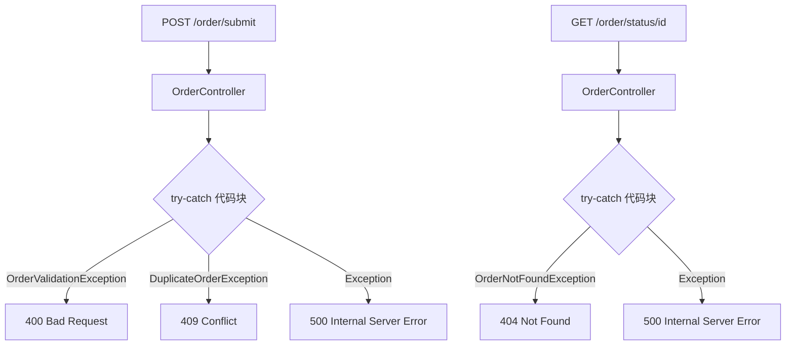
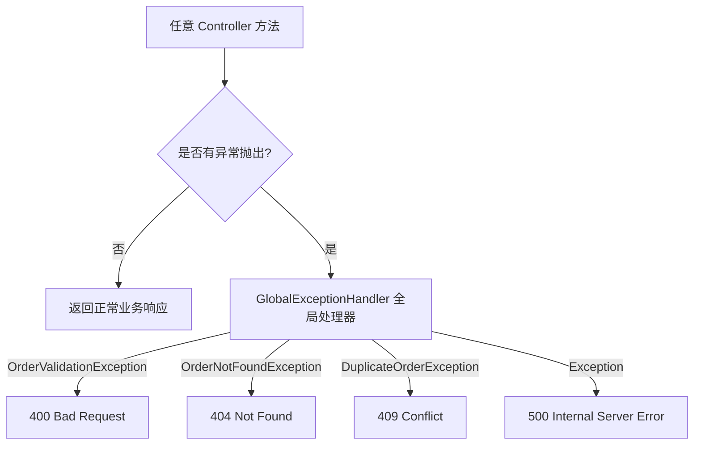

# 任务 12 ~ 基于 @ControllerAdvice 的全局异常处理

在任务 2 中，我曾提到使用 `@ControllerAdvice` 是在整个应用程序中处理异常的一种更加优雅的方式，而不是在每个 controller 方法中都包裹 try-catch 代码块。当时我们没有立即实现它，是因为重点在于理解异常如何在各层之间传播。现在是时候以标准优雅的方式重构它了。

本任务将引导你使用单个集中的异常处理器替换 `OrderController` 中零散的异常处理逻辑。你还将学习 **RFC 7807 Problem Details**，这是 REST API 传递错误的标准响应格式，Spring Boot 3 原生开箱即用支持该规范。

---

## 现有方案存在的问题

打开 [OrderController.java](../../src/main/java/com/springboot/learning/kit/controller/OrderController.java) 并观察其中的两个方法。每个方法都拥有自己的 `try-catch` 块，分别捕获相同的异常集合，并手动构建包含 `Map.of("message", ...)` 请求体的 `ResponseEntity`：

```java
@PostMapping("/submit")
public ResponseEntity<?> submitOrder(@RequestBody OrderRequest orderRequest) {
    try {
        orderProcessingService.processNewOrder(orderRequest);
        return ResponseEntity.ok("Order submitted successfully");
    } catch (OrderValidationException e) {
        log.error("Order validation failed: {} ~ ", orderRequest.getUUID(), e);
        return ResponseEntity.status(HttpStatus.BAD_REQUEST).body(Map.of("message", e.getMessage()));
    } catch (DuplicateOrderException e) {
        log.error("Order already exists in the DB: {} ~ ", orderRequest.getUUID(), e);
        return ResponseEntity.status(HttpStatus.CONFLICT).body(Map.of("message", e.getMessage()));
    } catch (Exception e) {
        log.error("Error processing order: {} ~ ", orderRequest.getUUID(), e);
        return ResponseEntity.status(HttpStatus.INTERNAL_SERVER_ERROR)
                .body(Map.of("message", "Encountered error while processing order: " + orderRequest.getUUID()));
    }
}
```

这种写法虽然能工作，但随着代码库的扩张，会迅速引发以下问题：

**异常到状态码的映射存在大量重复**。如果明天你决定让 `OrderValidationException` 返回不同的状态码或更丰富的响应体，你必须逐个查找并修改捕获该异常的每一个 controller。在真实的微服务或大型应用中，这可能涉及数十处地方。

**错误响应格式不规范且不一致**。目前响应体是随意定义的 `{"message": "..."}`。如果你想添加第二个字段（例如错误代码或时间戳），必须修改所有手动组装该 Map 的代码。

**Controller 被错误处理逻辑严重污染**。Controller 的核心职责是接收请求并返回响应，大量的异常捕获代码掩盖了真正的业务流程，降低了代码可读性。

目前的调用链路如下所示：



每个 controller 端点都需要自行负责错误路由。想象一下如果项目中再增加 5 个 controller，你将不得不在每个方法中反复编写相同的 catch 块。

---

## 什么是 @ControllerAdvice？

`@ControllerAdvice` 是一个 Spring 注解，允许你在单一类中集中定义异常处理方法，并自动应用于应用程序中的**所有** Controller。当任何 controller 方法向外抛出未捕获的异常时，Spring 会在向客户端发送响应之前拦截该异常，并检查是否存在针对该异常类型的 `@ControllerAdvice` 处理方法。

这彻底将错误处理逻辑与 Controller 业务逻辑分离开来。Controller 只需专注于业务执行并在出错时抛出异常，无需关心哪个异常映射到哪个 HTTP 状态码——这完全是全局处理器的职责。

引入集中处理器后，调用流程转变为：



核心优势在于：**异常路由逻辑集中定义在一个类中，并自动对所有 Controller 生效**。

---

## RFC 7807 Problem Details 规范

在编写处理器之前，我们先来了解将要使用的响应格式。

当前应用程序的错误响应格式为：
```json
{
  "message": "UUID cannot be null"
}
```

这种格式是非标准的。如果客户端程序需要自动化处理该错误，它必须解析该 message 字符串。一旦文案微调，客户端逻辑就会损坏。RFC 7807（"Problem Details for HTTP APIs"）为 HTTP 错误响应定义了标准化结构：

```json
{
  "type": "about:blank",
  "title": "Order Validation Failed",
  "status": 400,
  "detail": "UUID cannot be null",
  "instance": "/order/submit"
}
```

- `type`：标识问题类型的 URI。在未提供特定文档链接时，默认值为 `about:blank`。
- `title`：问题类型的简短概括，多次发生时应保持稳定一致。
- `status`：HTTP 状态码。
- `detail`：针对本次具体发生错误的详细原因说明。
- `instance`：标识导致该错误的特定请求 URI 路径。

Spring Boot 3 原生提供了 `ProblemDetail` 类来直接表示此格式，无需引入任何额外第三方依赖。

---

## 创建 GlobalExceptionHandler

在 `exception` 包下创建一个名为 `GlobalExceptionHandler` 的新类。所有异常与响应的映射关系都将集中在此处维护。

该类必须标注 `@RestControllerAdvice` 注解。这是将 `@ControllerAdvice` 与 `@ResponseBody` 合二为一的复合注解，意味着处理器方法返回的任何对象都会像在 `@RestController` 中一样自动被序列化为 JSON。

我们还将继承 `ResponseEntityExceptionHandler`，这是 Spring 提供的基础类，已经默认处理了所有标准 Spring MVC 异常（例如请求体格式非法时的 `HttpMessageNotReadableException`）并将其映射为标准的 `ProblemDetail` 响应。继承它意味着我们免费获得了这些标准映射，只需专注于为自定义业务异常编写处理器即可：

```java
package com.springboot.learning.kit.exception;

import jakarta.servlet.http.HttpServletRequest;
import java.net.URI;
import lombok.extern.slf4j.Slf4j;
import org.springframework.http.HttpStatus;
import org.springframework.http.ProblemDetail;
import org.springframework.web.bind.annotation.ExceptionHandler;
import org.springframework.web.bind.annotation.RestControllerAdvice;
import org.springframework.web.servlet.mvc.method.annotation.ResponseEntityExceptionHandler;

@Slf4j
@RestControllerAdvice
public class GlobalExceptionHandler extends ResponseEntityExceptionHandler {

    @ExceptionHandler(OrderValidationException.class)
    public ProblemDetail handleOrderValidationException(OrderValidationException ex, HttpServletRequest request) {
        log.error("Order validation failed: {}", ex.getMessage());
        ProblemDetail problemDetail = ProblemDetail.forStatusAndDetail(HttpStatus.BAD_REQUEST, ex.getMessage());
        problemDetail.setTitle("Order Validation Failed");
        problemDetail.setInstance(URI.create(request.getRequestURI()));
        return problemDetail;
    }

    @ExceptionHandler(OrderNotFoundException.class)
    public ProblemDetail handleOrderNotFoundException(OrderNotFoundException ex, HttpServletRequest request) {
        log.error("Order not found: {}", ex.getMessage());
        ProblemDetail problemDetail = ProblemDetail.forStatusAndDetail(HttpStatus.NOT_FOUND, ex.getMessage());
        problemDetail.setTitle("Order Not Found");
        problemDetail.setInstance(URI.create(request.getRequestURI()));
        return problemDetail;
    }

    @ExceptionHandler(DuplicateOrderException.class)
    public ProblemDetail handleDuplicateOrderException(DuplicateOrderException ex, HttpServletRequest request) {
        log.error("Duplicate order detected: {}", ex.getMessage());
        ProblemDetail problemDetail = ProblemDetail.forStatusAndDetail(HttpStatus.CONFLICT, ex.getMessage());
        problemDetail.setTitle("Duplicate Order");
        problemDetail.setInstance(URI.create(request.getRequestURI()));
        return problemDetail;
    }

    @ExceptionHandler(OrderProcessingException.class)
    public ProblemDetail handleOrderProcessingException(OrderProcessingException ex, HttpServletRequest request) {
        log.error("Order processing failed: {}", ex.getMessage());
        ProblemDetail problemDetail =
                ProblemDetail.forStatusAndDetail(HttpStatus.INTERNAL_SERVER_ERROR, ex.getMessage());
        problemDetail.setTitle("Order Processing Failed");
        problemDetail.setInstance(URI.create(request.getRequestURI()));
        return problemDetail;
    }

    @ExceptionHandler(Exception.class)
    public ProblemDetail handleGenericException(Exception ex, HttpServletRequest request) {
        log.error("Unexpected error at {}: {}", request.getRequestURI(), ex.getMessage(), ex);
        ProblemDetail problemDetail =
                ProblemDetail.forStatusAndDetail(HttpStatus.INTERNAL_SERVER_ERROR, "An unexpected error occurred");
        problemDetail.setTitle("Internal Server Error");
        problemDetail.setInstance(URI.create(request.getRequestURI()));
        return problemDetail;
    }
}
```

几点关键说明：

每个方法上的 `@ExceptionHandler` 注解告诉 Spring 该方法负责处理哪个具体的异常类型。当对应异常从 Controller 抛出时，Spring 会自动路由至该方法。

当异常类型之间存在继承关系时，方法的匹配顺序由异常特异度决定：Spring 始终优先匹配**最精确特化**的异常类型。底部的 `@ExceptionHandler(Exception.class)` 作为兜底捕获，负责处理未被显式捕获的其他未知异常，其作用等同于以前 controller 中的 `catch (Exception e)`。

`HttpServletRequest` 参数由 Spring 自动注入，无需手动获取，用于为 `instance` 字段填充请求路径。

每个处理器中的 `log.error` 统一收拢了日志输出，这意味着全应用中所有未处理的异常都能在同一个类中以一致的规范记录日志。

---

## 为 Spring MVC 原生异常启用 Problem Details

默认情况下，Spring Boot 3 会对你的 `@ExceptionHandler` 方法使用 `ProblemDetail`，但对于标准的 Spring MVC 异常（如缺少必要请求参数、不支持的 HTTP Method），除非主动开启，否则仍会返回旧式的错误响应体。

在 [application.properties](../../src/main/resources/application.properties) 中添加以下配置项：

```properties
spring.mvc.problemdetails.enabled=true
```

开启后，`GlobalExceptionHandler` 继承的 `ResponseEntityExceptionHandler` 也会为所有标准 Spring MVC 异常统一返回 `ProblemDetail` 格式，从而让整个应用程序的所有错误响应格式完全统一。

---

## 重构 OrderController

集中异常处理器就绪后，Controller 不再需要处理任何异常捕获逻辑。打开 [OrderController.java](../../src/main/java/com/springboot/learning/kit/controller/OrderController.java) 并移除所有 try-catch 块。重构后的类如下所示：

```java
package com.springboot.learning.kit.controller;

import com.springboot.learning.kit.dto.request.OrderRequest;
import com.springboot.learning.kit.service.OrderProcessingService;
import com.springboot.learning.kit.service.OrderStatusService;
import lombok.RequiredArgsConstructor;
import lombok.extern.slf4j.Slf4j;
import org.springframework.http.ResponseEntity;
import org.springframework.web.bind.annotation.*;

@Slf4j
@RestController
@RequestMapping("/order")
@RequiredArgsConstructor
public class OrderController {

    private final OrderProcessingService orderProcessingService;
    private final OrderStatusService orderStatusService;

    /**
     * 提交订单处理的端点接口。
     *
     * @param orderRequest 待处理的订单
     * @return 表示操作结果的 ResponseEntity
     */
    @PostMapping("/submit")
    public ResponseEntity<String> submitOrder(@RequestBody OrderRequest orderRequest) {
        orderProcessingService.processNewOrder(orderRequest);
        return ResponseEntity.ok("Order submitted successfully");
    }

    @GetMapping("/status/{orderId}")
    public ResponseEntity<?> getOrderStatus(@PathVariable Long orderId) {
        return ResponseEntity.ok(orderStatusService.getOrderStatus(orderId));
    }
}
```

Controller 现在仅导入真正需要的类。原先导入的各类异常类、`HttpStatus` 和 `Map` 全部被清理，因为它们本就不该属于 Controller 层。

注意，`submitOrder` 的返回类型从 `ResponseEntity<?>` 精确为 `ResponseEntity<String>`。这是因为该方法在正常情况下始终返回带有字符串响应体的 `200 OK`。以前之所以使用 `?` 通配符，仅仅是为了在 catch 块中兼容不同格式的错误响应体。

---

## 测试验证改动

重启应用程序，测试之前各个任务中涉及的异常场景。

**校验失败场景 (400)：**

提交 UUID 为 null 的订单，响应体现在遵循规范的 Problem Details 格式：

```json
{
  "type": "about:blank",
  "title": "Order Validation Failed",
  "status": 400,
  "detail": "UUID cannot be null",
  "instance": "/order/submit"
}
```


**重复订单场景 (409)：**

连续提交相同的订单两次，你将收到：

```json
{
  "type": "about:blank",
  "title": "Duplicate Order",
  "status": 409,
  "detail": "Order already exists with UUID: 1234567",
  "instance": "/order/submit"
}
```


**订单不存在场景 (404)：**

使用数据库中不存在的 UUID 调用 `GET /order/status/{id}`：

```json
{
  "type": "about:blank",
  "title": "Order Not Found",
  "status": 404,
  "detail": "Order not found with UUID: 9999999",
  "instance": "/order/status/9999999"
}
```


无论发生何种错误，响应体现在都具备高度一致的结构。调用该 API 的客户端可以稳定获得 `status`、`title`、`detail` 和 `instance` 字段，开发体验大幅提升。

---

## 总结

在本任务之前，每个 controller 方法都必须手动捕获异常并决定返回什么 HTTP 状态码。现在这些逻辑被完整归纳至单一类中。当项目新增自定义异常时，只需要在这一处集中维护处理规则。

迁移至 `ProblemDetail` 为所有错误响应赋予了标准化的规范形态。客户端无需再脆弱地解析不规则的字符串消息，能够更可靠地根据状态码和详情进行业务容错。

最后，Controller 本身变得更加纯粹干净，方法签名更加严谨，业务逻辑不再淹没在冗长的 catch 样板代码中。系统的每一层职责都更加清晰专注。
